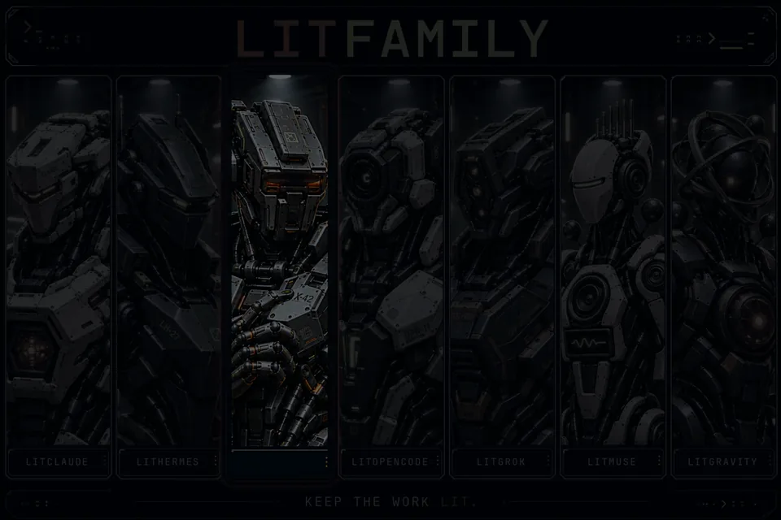
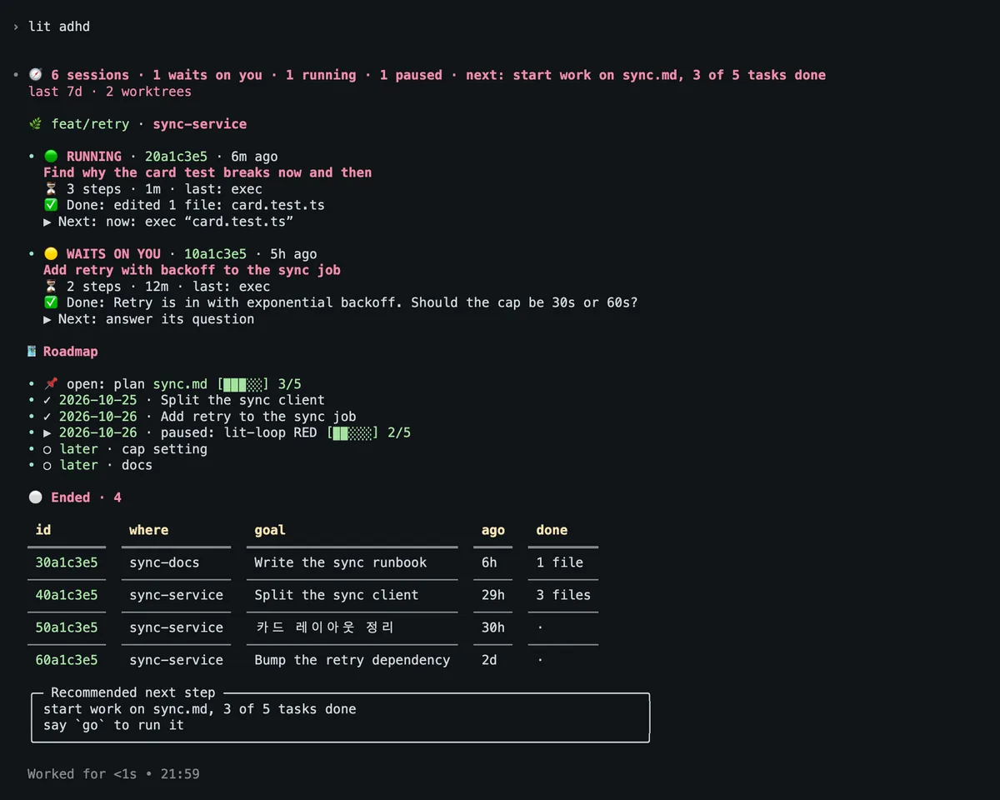
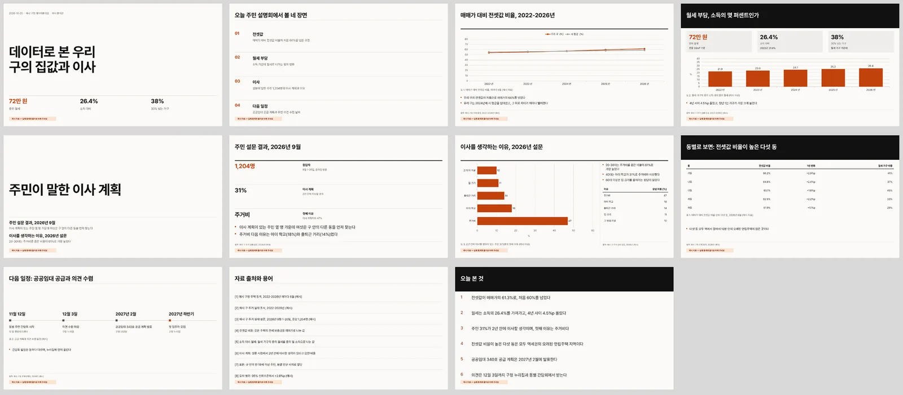
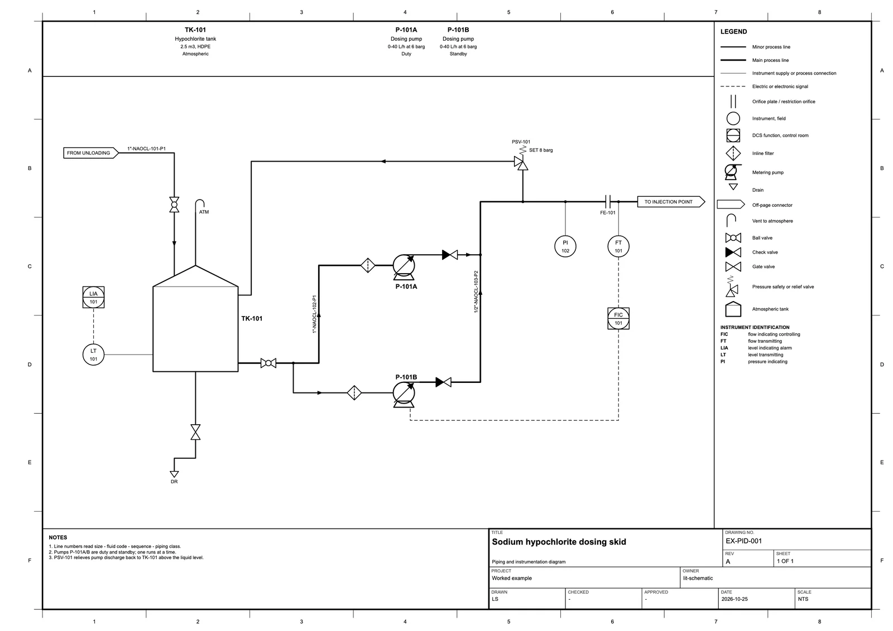
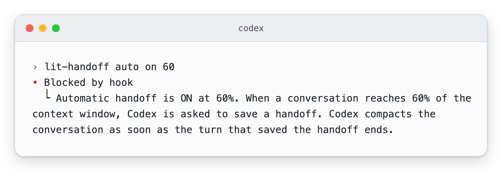
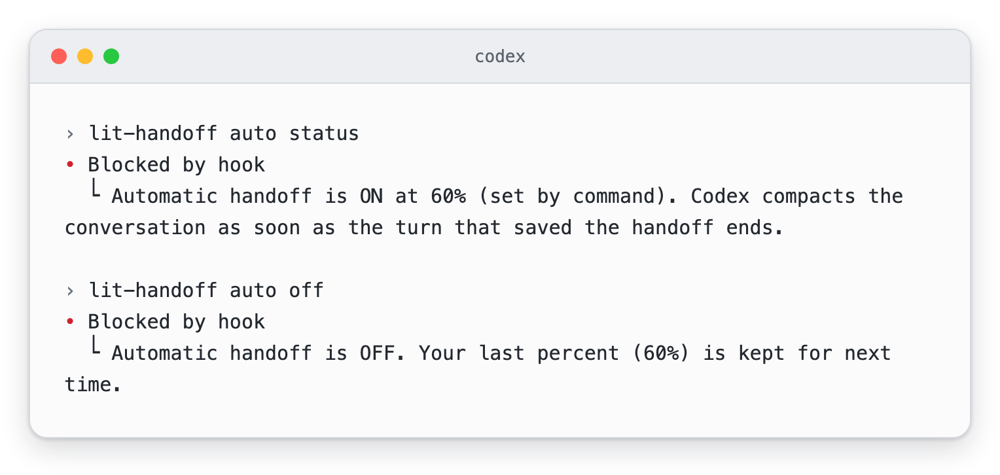
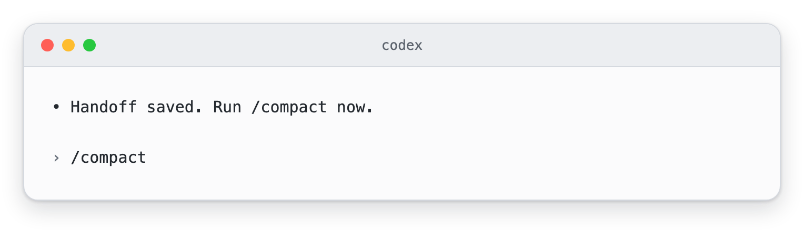
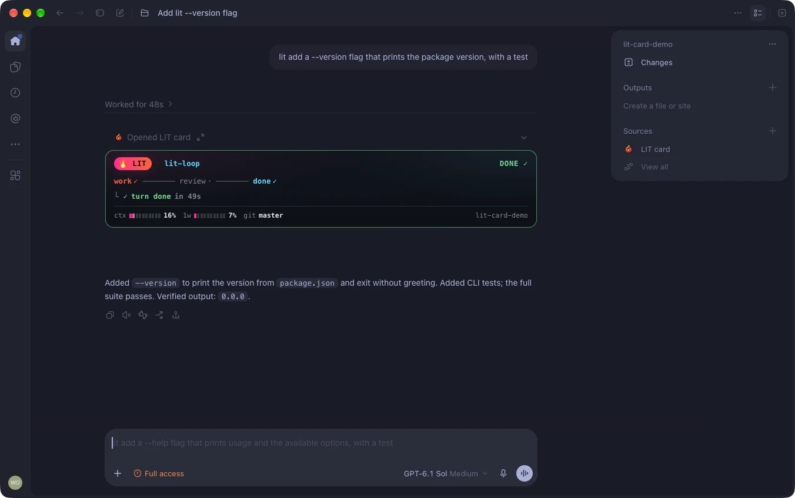
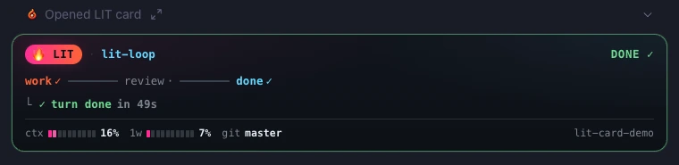

<p align="center"><picture><source media="(prefers-reduced-motion: reduce)" srcset="./docs/assets/cover-motion-still.webp" /></picture></p>

# LitCodex

**Keep the work lit.**

Put `lit` in front of a request and Codex CLI works toward checks that can pass or fail, calling the job
done only when each one has proof. The proof stays in your project, so tomorrow's session starts where
today's stopped.

<p>
<a href="https://www.npmjs.com/package/@litfamily/litcodex"></a>
<a href="https://www.npmjs.com/package/@litfamily/litcodex"></a>
<a href="./LICENSE"></a>
<a href="https://github.com/wjgoarxiv/litcodex/stargazers"></a>
</p>

[한국어](./README-Ko-KR.md) · [Install](#install) · [First task](#start-with-lit) · [What you get](#what-you-get) · [Commands](#commands) · [Learn more](#learn-more)

> [!TIP]
> Run the one line under [Install](#install), approve the LitCodex hooks when Codex asks, then type `lit` and your
> request, as in [Start with lit](#start-with-lit).

The short film below is one real turn: a test written first, a failing run, the fix, and a passing run
before Codex says the turn is done.

<p></p> <!-- demo-gif -->

## What is LitCodex

Codex CLI is quick at the next step, and the trouble starts when a piece of work is bigger than one conversation.
The context fills up or the session ends, and the next session has to work out again what was decided, what was
checked and what was left half done. Somewhere along the way, a change that nobody actually verified gets called finished.

LitCodex is a plugin for Codex CLI that keeps that thread. A `lit` request becomes a goal that counts as finished only
when every check has recorded evidence, and any later session can read those records. Send the single word `handoff`
before you stop, and the next session starts from a written note of where you were.

Around that loop come more than forty skills for planning, code review, research, debugging, Word and PowerPoint
files, and English or Korean prose. The work runs inside Codex on your machine, with your own sign-in and models.

It is built for people who already use Codex CLI on work that outlasts one sitting: a feature that takes a few days,
a refactor you want planned before anyone edits, research you need with sources, a report or deck that has to end up
as a real file. In one line: Codex stops calling unchecked work done, and you stop explaining the same project twice.

## Pick your path

| I want to… | Do this | Go to |
| --- | --- | --- |
| Install it | Run one `npm exec` line | [Install](#install) |
| Run a first task | Type `lit` and a request | [Start with lit](#start-with-lit) |
| See what it does | Read the features and the gallery | [What you get](#what-you-get) |
| Add decks, documents or figures | Install an extension | [Extensions](#extensions) |
| Look something up | Prompt routes and CLI commands | [Commands](#commands) |
| Fix or remove it | Doctor, troubleshooting, uninstall | [Troubleshooting](#troubleshooting) |

## Install

You need Node.js 22 or later and Codex CLI. Run from any folder:

```sh
npm exec --yes --package @litfamily/litcodex@1.0.39 -- litcodex install
```

The installer asks three questions (which model leads, which model helps, and which output style you like), and
pressing Enter keeps the recommended models and your current output style. It then shows the route it is about to
write and waits for one more Enter before it registers the plugin, its hooks and its agent roles, changing only the
keys it manages in `~/.codex/config.toml`. When the receipt says `Status Ready for Codex`, the doctor check has
already passed.

| You want | Run | What changes |
| --- | --- | --- |
| The plan first | `npm exec --yes --package @litfamily/litcodex@1.0.39 -- litcodex --dry-run install` | Prints every step and writes nothing |
| The defaults, no questions | Add `--yes` after `install` | Keeps the defaults without asking |
| `litcodex` on your `PATH` | `npm install -g @litfamily/litcodex`, then `litcodex install` | Also readies the video skill's rendering tools |

A global install fetches a few pinned downloads for those rendering tools; the
[install guide](./docs/install.md#a-global-command) lists them and shows how to skip them.

> Without a global install, use `npm exec --yes --package @litfamily/litcodex@1.0.39 -- litcodex <command>`, such as `npm exec --yes --package @litfamily/litcodex@1.0.39 -- litcodex doctor`.

The [install guide](./docs/install.md) also covers trying LitCodex in a home of its own, Windows, and pictures of
every screen the installer shows. Coming from the old unscoped package? The [migration guide](./docs/npm-migration.md)
covers the move.

The installer also offers a short LitFamily block for your global `~/.codex/AGENTS.md`, the file Codex reads at the
start of every session, and you can switch it, and a no-attribution request inside it, on or off later.

<details>
<summary>The global AGENTS.md block and commit attribution</summary>

The block only sets the ground rules: where plans, handoffs and run state live, and that nothing is pushed or called
done without the checks.

- **Interactive install:** asks once and writes it on a yes.
- **`install --yes`:** writes it without asking.
- **Quiet install without `--yes`:** only tells you how to add it later.
- **`--no-agent-file`:** skips it for that run.

The switch stays yours afterwards:

```sh
litcodex config agentFile off   # remove the block and keep it off
litcodex config agentFile on    # write it back
```

Codex adds its own `Co-authored-by` trailer and pull request line from an account setting in your ChatGPT settings
(Codex describes the account's Git section in its [developer settings](https://learn.chatgpt.com/docs/developer-settings)),
so LitCodex cannot switch it off from `config.toml`. What it can do is ask the model: `litcodex config attribution off`
adds one line to the block (do not add `Co-Authored-By` lines or other AI attribution to commits or pull requests),
and `litcodex config attribution keep` takes it out again.

That line is a request and carries no guarantee, and `config.toml` is never touched. The default is `keep`: an
interactive install asks once (default no), `install --yes` changes nothing, and `uninstall` returns it to `keep`.

```sh
litcodex config attribution off    # add the request line to the block
litcodex config attribution keep   # take it out
```

`litcodex doctor` reports the block as its `agent file:` row and the choice as `attribution:`. In a repo, `lit-init`
already writes project `AGENTS.md` files; `litcodex agent-file project --dir <path>` adds the matching project block to one.

</details>

### What the installer writes

Once you confirm the route, the installer adds the LitCodex marketplace, installs the plugin from it, registers the
hooks that come bundled with the plugin, puts seven agent roles next to your own, changes the keys it manages in
`config.toml`, and ends with a doctor run. The global `AGENTS.md` block is the one thing it asks about separately.

<p align="center">
  <picture>
    <source media="(prefers-color-scheme: dark)" srcset="./docs/assets/readme/diagrams/install-map.en.dark.png">
    
  </picture>
</p>

> [!NOTE]
> The bottom row matters most on the first day: nothing happens on a `lit` prompt until Codex has asked you to review
> the LitCodex hooks and you have approved them, so restart Codex after the install and answer that review.

The red band is what the installer leaves alone: your extension copies under `~/.codex/skills/`, the rest of your
`config.toml`, and the Git attribution setting that lives in your ChatGPT account.

### Let a coding agent install it

You can also hand the install to a coding agent such as Codex itself. The agent checks what you have, shows you the
plan and waits for your yes before it changes anything, then runs the doctor check and tells you what it found.

<details>
<summary>The prompt to paste into the agent</summary>

```text
Install LitCodex, a plugin for Codex CLI, on this machine. Follow these steps in order.

1. Check that Node.js 22 or later and Codex CLI are installed (node --version, codex --version).
   If either is missing, stop and tell me what to install.
2. Use only the official npm package @litfamily/litcodex. Do not install a package with a similar
   name, and do not download install scripts from anywhere else.
3. Show me the plan first. Run this command, which prints every step and writes nothing:
   npm exec --yes --package @litfamily/litcodex@1.0.39 -- litcodex --dry-run install
   Summarize what it will change, then ask me whether to go ahead. Do not continue until I say yes.
4. After I say yes, run:
   npm exec --yes --package @litfamily/litcodex@1.0.39 -- litcodex install --yes
   (--yes keeps the recommended models and my current output style.)
5. Run the check and report its result to me, quoting any issue or warning exactly:
   npm exec --yes --package @litfamily/litcodex@1.0.39 -- litcodex doctor
6. Remind me to restart Codex so it loads the plugin, and to approve the LitCodex hooks when Codex
   asks me to review them.
```

</details>

## Start with lit

Open Codex in your project. The first time, Codex asks you to review the LitCodex hooks; approve them.
Then type:

```text
lit add input validation to the signup form
```

The hook answers before the model does: a five-row LIT mark appears, sent by the `UserPromptSubmit` hook as plain
text, and the reply opens with `🔥 **LIT IGNITED · <discipline>** 🔥`. From there the request runs in the work loop
(`<lit-loop-mode>` internally): a goal, its checks, and evidence recorded as each check passes. Under the mark sits a
small LIT card, so you can see at a glance how far the work has come:

```text
┃ 🔥 LIT · lit-loop  turn started
┃ ✓ INTERVIEW  ›  ✓ PLAN  ›  🔨 WORK ▰▰▰▱▱▱▱ 3/7  ›  🔍 REVIEW  ›  🏁 DONE
┃ ✓ Render the map
┃ ▸ Show the map in the terminal
┃ · Write the docs
```

<details>
<summary>How to read the card</summary>

The second row is the map. Read left to right, that is the interview, the plan, the work with a bar of finished plan
tasks, review and done. Finished stages carry a ✓; with card colour on, the current stage is bold orange and later
stages are dimmed.

Below it are up to three rows of the plan or the lit-loop goals: the last one finished, the open one and the next. The
card is drawn from what the project has actually saved, so a stage with nothing behind it is left out. Research has a
map of its own (decomposition, waves, verification, synthesis) that resumes from the research journal in progress, or
starts at decomposition when there is none.

When a LIT turn ends, the Stop hook draws the same card with a summary in its first row, such as
`✨ turn done · 2 tasks ✓ · next ▸ Write the docs`. If `lit start work` reaches a checkpoint and keeps going in the same
turn, the summary reads `⏳ 3/7 tasks ✓ · continuing ▸ Write the docs` instead. The card is plain text by default,
because the Codex desktop app and IDE show colour codes in hook text as raw characters.

</details>

LitCodex listens for `lit` as a word of its own. Words that merely contain the letters, such as `split`,
`literal` or `litmus`, pass through untouched, and so does `lit` inside a code span or a code block.
Slash commands are left alone as well, with one exception: `/litresearch` starts research.

Two words are exact-only routes that work only when they are the whole message. Send exact bare `handoff` before you
leave a session, and LitCodex writes a continuation packet for the next one. Send exact bare
`lit-scientific-visualization` when you want publication plots; it switches to plotting mode
(`<lit-scientific-visualization-mode>`) and installs no Python packages.

### Make one small thing

For a first run you can judge yourself, try this in an empty folder:

```text
lit build a single-file HTML task list in this folder. Do not install dependencies.
Check adding and completing a task, and record anything you could not verify.
```

When it finishes, look at three things: the page itself (open it and add a task), the checks that actually ran, and
what is still open. `lit recap` reads back what was recorded. Send `handoff` on its own before you close the session,
and in the next one ask Codex to read that packet and the project goals first.

## What you get

- **Work that finishes for real.** `lit` turns a request into a goal with checks; a goal can be completed only once
  every check has passing evidence, and anything Codex could not verify is written down where you will see it.
  Try `lit fix the flaky login test and show me the run that proves it`.
- **A plan before the edits.** `lit plan` writes a plan with numbered steps and success criteria into
  `.litcodex/plans/` and edits nothing else. Once you approve it, `lit start work <plan-name>` runs each step through
  five gates (re-read, automated checks, manual QA, adversarial QA, cleanup) and finishes only after all five review
  lanes pass. Try `lit plan move the settings page to the new form library`.
- **Reviews that can say no.** `lit review` runs five separate reviews of a plan or a finished change, and any one of
  them can hold back approval.
- **Research with sources.** `lit research` gathers evidence in parallel and writes a cited synthesis that keeps facts,
  hypotheses and open questions apart. Try `lit research which Node 22 OAuth libraries support PKCE, with sources`.
- **Word and PowerPoint files.** Ask for a report or slides with `lit` and the matching skill (`lit-docx` or
  `lit-pptx`) reads your material, picks a design direction, names it with two alternatives, and builds an editable
  file with its Markdown source next to it. Try `lit turn notes.md into a ten-slide deck for the Monday review`; both
  skills are now [extensions](#extensions).
- **Cleaner prose, in English or Korean.** `$litcodex:lit-humanizer` rewrites stiff model writing while keeping facts
  and hedges. Before a file is written, its hook stops a few clear drafting tells.

### Also in the box

Every skill can be picked in the Codex skill picker or mentioned by name, such as `$litcodex:debugging`.
[The skills page](./docs/skills.md) has a picture and a one-line description for each.

| For | Skills |
| --- | --- |
| Code | `debugging`, `refactor`, `lit-code`, `lit-commit`, `lit-burnoff`, `lit-burnoff-file`, `structural-search`, `lsp-setup`, `lit-init` |
| Planning and teams | `deep-interview`, `lit-brainstorm`, `lit-crucible`, `litgoal`, `litwork`, `lit-team` |
| Research and knowledge | `autoresearch`, `autoconference`, `wikify`, `lit-fetch`, `coding-session-audit`, `lit-comprehend`, `lit-hijack`, `lit-adhd` |
| Screens, figures and film | `frontend-ui-ux`, `visual-qa`, `browser-drive`, `readme-studio`, `lit-diagram-drawer`, `lit-schematic`, `lit-scientific-visualization`, `lit-typographic-motion` |
| Keeping LitCodex healthy | `litcodex-doctor`, `litcodex-report-bug`, `litcodex-contribute-bug-fix` |
| Running on their own | `rules`, `lsp` and `comment-checker`: project rules on each prompt, LSP and comment checks after edits |

Apart from `browser-drive`, the screens, figures and film skills moved to wjgoarxiv-skills, a separate collection of content
skills, along with `lit-docx` and `lit-pptx`. Their names still work here: each one is a short stub that tells you where the skill went and how to copy
it into `~/.codex/skills/`, and until you copy it, it answers with the one-line Codex install command.

## Extensions

LitCodex carries the LitFamily core: the `lit` loop, plans, reviews, research, handoffs and the rest of the workflow.
That core is complete and works on its own.

<p align="center">
  <picture>
    <source media="(prefers-color-scheme: dark)" srcset="./docs/assets/readme/diagrams/core-extensions.en.dark.png">
    
  </picture>
</p>

Nine skills that make files are LitFamily extensions: `lit-pptx` (decks), `lit-docx` (documents),
`lit-diagram-drawer`, `lit-schematic` and `lit-scientific-visualization` (figures), `frontend-ui-ux` and
`visual-qa` (design), and `lit-typographic-motion` and `readme-studio` (video and covers). They are kept in the
extension shelf, [wjgoarxiv-skills](https://github.com/wjgoarxiv/wjgoarxiv-skills); install the ones you use
alongside LitCodex to get the full LitFamily experience.

Each one is a folder that goes into Codex's own skills folder, and LitCodex can put it there for you. Every command
below only prints its plan until you add `--yes`:

```bash
litcodex extensions list
litcodex extensions install lit-docx --yes
litcodex extensions install --family figures --yes
litcodex extensions check
litcodex extensions update --yes
```

<details>
<summary>What each extensions command does</summary>

| Command | What it does |
| --- | --- |
| `list` | Shows which of the nine are installed, which folders are yours (they have no receipt), and any same-name skill elsewhere that Codex would also list |
| `install` | Does what the four manual lines below do; stops when a same-name skill sits in `~/.agents/skills` or the project's skill folders, because LitCodex never touches those |
| `update` | Fetches its clone of the shelf again and reinstalls whatever changed |
| `remove <id>` | Moves an installed copy to the backups and refuses a folder you made yourself |
| `check` | Changes nothing and prints a fix line for each problem it finds |
| `prune-backups` | Lists the backups with their sizes and deletes them only with `--yes` |

When nothing blocks it, `install` moves an old copy whole to `~/.codex/extension-backups/<date-time>/`, copies a fresh
one and leaves a receipt. Without `--from <path to your clone>` it keeps its own small clone of the shelf, holding
only the Codex editions, in `~/.cache/litcodex/extensions-src`, so the first install needs `git` and a network
connection. `litcodex doctor` prints a one-line summary of the same check.

</details>

<details>
<summary>Install an extension by hand (four lines)</summary>

To do the same by hand, clone the shelf once, then run four lines from your project folder, with your clone path in
place of the placeholder. For `lit-docx`:

```bash
git clone https://github.com/wjgoarxiv/wjgoarxiv-skills
cx="${CODEX_HOME:-$HOME/.codex}"; p="$(git rev-parse --show-toplevel 2>/dev/null || pwd)"; for d in "$cx/skills" "$HOME/.agents/skills" "$p/.agents/skills" "$p/.codex/skills"; do [ -e "$d/lit-docx" ] && echo "found: $d/lit-docx"; done; echo "check done"
cx="${CODEX_HOME:-$HOME/.codex}"; if [ -e "$cx/skills/lit-docx" ]; then b="$cx/extension-backups/$(date +%Y%m%d-%H%M%S)"; mkdir -p "$b" && [ ! -e "$b/lit-docx" ] && mv "$cx/skills/lit-docx" "$b/lit-docx" && echo "moved aside: $b/lit-docx"; fi
cx="${CODEX_HOME:-$HOME/.codex}"; if [ -e "$cx/skills/lit-docx" ]; then echo "stopped: $cx/skills/lit-docx still exists"; else mkdir -p "$cx/skills" && cp -R "<path to your wjgoarxiv-skills clone>/variants/litcodex/lit-docx" "$cx/skills/lit-docx"; fi
cx="${CODEX_HOME:-$HOME/.codex}"; [ -f "$cx/skills/lit-docx/SKILL.md" ] && printf '{"id":"lit-docx","source":"%s","variant":"litcodex","installed_at":"%s"}\n' "<path to your wjgoarxiv-skills clone>/variants/litcodex/lit-docx" "$(date -u +%Y-%m-%dT%H:%M:%SZ)" > "$cx/skills/lit-docx/.litfamily-extension.json"
```

| Line | What it does |
| --- | --- |
| 1 | Looks for a `lit-docx` folder in every place Codex reads skills from: `~/.codex/skills`, `~/.agents/skills`, and the project's `.agents/skills` and `.codex/skills` |
| 2 | Moves your old copy in `~/.codex/skills` whole to `~/.codex/extension-backups/<date-time>/lit-docx`, where Codex does not look |
| 3 | Copies into the now-empty folder and stops if the folder is still there, so a copy never lands inside an old one |
| 4 | Leaves a small receipt, `.litfamily-extension.json`, inside the installed folder |

If the first line finds a copy anywhere other than `~/.codex/skills`, Codex would list both, so move that folder out
yourself. To update, pull the clone and run the four lines again. To remove an extension, run only the second line.

</details>

Start a new Codex session afterwards. Without an extension the name still works: `$litcodex:lit-pptx` and the
other stubs say what the skill makes and print its own copy line. `litcodex install` and upgrades never write
`~/.codex/skills/`, so your copies stay.

<details>
<summary>What an upgrade tells you, keeps and leaves behind</summary>

LitCodex says this once when it installs or upgrades, and once more in the first Codex session after that. If you
added or changed files inside its skill folders, an upgrade first saves them to `~/.codex/litcodex-backups/<date>/`
and the install output names that folder.

Versions up to 1.0.38 kept office and film runtimes in `~/.cache/litcodex/office` and
`~/.cache/litcodex/motion-runtime`. LitCodex no longer uses them, so you can delete them if you do not install the
extensions.

</details>

## What you can make

Four pictures, each made by running a skill's own scripts on this machine. The deck, the page and the P&ID come from
skills that now live in wjgoarxiv-skills, and every figure in them is example data.

### Where was I

Prompt: `lit adhd`. `lit-adhd` reads your recent Codex sessions and lays out what waits on you, what runs, what ended and one next step. This brief is built from fixture sessions and drawn by the Codex terminal.

<p align="center"></p>

### A deck

Prompt: `lit turn the district rent survey into a ten-slide briefing, newsroom style`. `lit-pptx` compiles Markdown into a native, editable deck with Pretendard embedded, then checks overflow, contrast and empty slides. This is the bundled newsroom example, rendered to page images.

<p align="center"></p>

### A page

Prompt: `lit build a landing page for a weekly transit ridership briefing, neo-brutalism`. `frontend-ui-ux` locks a house style first, builds on its kit and then probes the page at 320, 390, 768 and 1440 pixels. Shown at 1440 and 390 pixels.

<p align="center"></p>

### A P&ID

Prompt: `lit draw a P&ID of a sodium hypochlorite dosing skid on one A3 sheet`. `lit-schematic` draws ISA-style symbols, tagged lines, a legend and a title block, and its QA gate passed on this sheet.

<p align="center"></p>

## Let LitCodex save the handoff for you

A long session fills the context window, and the next context starts without what this one learned. Sending
`handoff` by hand works only if you notice in time, so the automatic handoff notices for you. It stays off until you
turn it on with a percent of the context window, sent as your whole prompt:

```text
lit-handoff auto on 60
```

LitCodex answers right away, and the prompt never reaches the model. The command also writes that percent into the
project's `.codex/config.toml`, so in a project you have trusted in Codex, Codex compacts by itself right after the
handoff is saved.

<p><picture><source media="(prefers-color-scheme: dark)" srcset="./docs/assets/auto-handoff/auto-handoff-on-dark.webp" /></picture></p>

`lit-handoff auto status` tells you what is set, and `lit-handoff auto off` turns it off and keeps your number for
next time.

<p><picture><source media="(prefers-color-scheme: dark)" srcset="./docs/assets/auto-handoff/auto-handoff-status-off-dark.webp" /></picture></p>

When a turn ends at or above your percent, the model saves the handoff, starts no other work, and tells you one
line. If Codex is not going to compact by itself, that line asks you to run `/compact`. After the compaction, the
next context starts from the handoff that was just saved.

<p><picture><source media="(prefers-color-scheme: dark)" srcset="./docs/assets/auto-handoff/auto-handoff-saved-dark.webp" /></picture></p>

The [automatic handoff guide](./docs/auto-handoff.md) covers the environment variables, the doctor line and what
happens in a project you have not trusted yet.

## Watch LIT work in the Codex app

In the Codex desktop app, LitCodex can show a small LIT card in the thread: which LIT skill is running, the workflow
map with the stage it is on, and the tool working right now with a clock beside it. The card updates by itself while
the agent works and slows down when nothing is happening.

<p></p>

<p></p>

> [!NOTE]
> The card needs the app's MCP Apps feature, which OpenAI still lists as under development; LitCodex never turns it
> on for you. The terminal `codex` cannot draw cards, so there the same request prints the map as text, and
> `litcodex doctor` shows a `card:` line.

<details>
<summary>Why each LIT prompt opens a fresh card</summary>

The app keeps a card where it was first drawn, so a long thread would scroll it out of view. Each prompt that starts
LIT therefore opens a fresh card next to the newest turn, and the earlier cards fold into one quiet line that says how
their turn ended and stop updating. Prompts that do not start LIT get no card of their own; the newest card keeps
following them.

</details>

## Watch LIT in a second window

The terminal `codex` has no room for a card, so LitCodex can draw it next door instead. Open a second terminal
window or tab, in any folder, and run:

```bash
litcodex hud
```

It finds the Codex session where LIT was active most recently and keeps its card live, and it moves to another LIT
session when you work there. `--session <id>` keeps it on one session, `--once` prints a single frame and exits, and
Ctrl-C quits and leaves the terminal as it was.

<details>
<summary>What the HUD shows and what it never touches</summary>

The card shows which LIT skill is running, the workflow map with the stage it is on, the next open task, and the tool
working right now with a clock beside it. The top line names the session, its project folder and when LIT last heard
from it.

The HUD only reads the small records LIT already keeps for that card. It never writes a file, never reads Codex's own
session logs and never talks to Codex, so closing it or killing it changes nothing in the session. A record it cannot
read shows up as one `cannot read …` line.

Colour follows `NO_COLOR`. Tested on macOS; Linux and Windows terminals are not tested yet.

</details>

## Colour the LIT card

The LIT card the hooks print is plain text by default. The terminal `codex` (0.162 or newer) can draw it in colour:
finished stages in green, the current stage in bold orange, later stages dimmed.

```bash
litcodex screen-status on
```

Turn colour on only if you use the terminal `codex`: the Codex desktop app and IDE extensions show the colour codes as
raw text in the hook rows, and the hook cannot tell which client is showing it. Without colour the card has the same
rows as plain text.

<details>
<summary>Off, status, overrides and the one-line status</summary>

`litcodex screen-status off` turns it off and `status` reports it. The setting is kept in
`$CODEX_HOME/litcodex/screen-status.json`; `LITCODEX_SCREEN_STATUS=1` or `0` overrides it, and `NO_COLOR` keeps the
card plain.

`litcodex statusline` prints the same status as a single line, such as
`🔥 LIT · lit-loop  🔨 WORK › 🔍 REVIEW › 🏁 DONE  ⠹ Bash 0:12`, for a terminal or tool that runs a command to fill its
status line. Codex itself cannot run one yet.

</details>

## Keep LIT under Codex in one terminal

```bash
litcodex run
```

This starts Codex in the same terminal and keeps the bottom four rows for a live LIT panel: the LIT skill and how long
the turn has run, the workflow map, the tool running now with its clock, and the open checklist row. Arguments for
Codex go after `--`, as in `litcodex run -- resume --last`, and reach it unchanged.

> [!NOTE]
> Ctrl-Z does not suspend Codex here (tested on macOS with Codex 0.163.0): quit with Ctrl-C, or run plain `codex`
> when you need job control.

<details>
<summary>How the panel stays put, and when it steps aside</summary>

Codex runs in a pseudo-terminal four rows shorter, so it lays out its whole screen in the space above and the panel
stays put while you type, scroll and resize.

The panel follows the newest LIT session that started working in this folder after `litcodex run` began; until then
it says, dimmed, that it is waiting for a LIT turn. It reads the same small records as `litcodex hud` and writes no
file. When Codex exits, the panel rows are cleared, the terminal is back to normal and the exit code is Codex's own.

The pseudo-terminal comes from `node-pty`, an optional package npm installs with LitCodex wherever a prebuilt binary
exists. Without it, outside a terminal, or in a terminal smaller than 40 columns by 12 rows, `litcodex run` prints
one note and starts Codex the usual way. Tested on macOS; Linux and Windows terminals are not tested yet.

</details>

## How it works

Codex runs everything here; LitCodex only adds hooks, skills and a small CLI. The route below follows one `lit` prompt
from the hooks to the evidence records in `.litcodex/lit-loop/` and the LIT card at the end of the turn.

<p align="center">
  <picture>
    <source media="(prefers-color-scheme: dark)" srcset="./docs/assets/readme/diagrams/lit-route.en.dark.png">
    
  </picture>
</p>

<details>
<summary>The route step by step</summary>

When you send a prompt, Codex runs four `UserPromptSubmit` hooks before the model sees it. `lit-loop` notices the word
`lit` and adds the LIT mark and the mode, the Start Work hook picks up a `lit start work` run, `rules` adds the project
rules that apply, and `wikify-knowledge` adds the local knowledge you have accepted.

The agent then reads the skill for that mode, for example `$litcodex:lit-loop`, with the LitCodex agent roles, and gets
on with the work. Every tool call passes the tool hooks on its way: Git safety, the prose check, comment checks and LSP
diagnostics.

Each check the agent finishes goes through `litcodex loop record-evidence`, and `litcodex loop checkpoint` closes a
goal only when all of its checks pass. Those records land in `.litcodex/lit-loop/`, which is how the next `lit` knows
where you stopped.

`lit review` runs `review-work` with its five lanes, and every `lit start work` plan ends there. When the turn ends,
the Stop hook draws the LIT card.

</details>

Here is the same route drawn as a small process plant: a `lit` prompt comes in on the left, and approved work leaves on
the right. When a review lane fails, the diverter sends the work back to the loop.

<p align="center">
  <picture>
    <source media="(prefers-color-scheme: dark) and (prefers-reduced-motion: reduce)" srcset="./docs/assets/readme/schematic/lit-plant.en.dark.png">
    <source media="(prefers-color-scheme: dark)" srcset="./docs/assets/readme/schematic/lit-plant-loop.en.dark.webp">
    
  </picture>
</p>

<p align="center"><sub>Still pictures: <a href="./docs/assets/readme/schematic/lit-plant.en.light.png">light</a> · <a href="./docs/assets/readme/schematic/lit-plant.en.dark.png">dark</a></sub></p>

<details>
<summary>Reading the plant</summary>

A `lit` prompt comes in on the left and passes the hooks. A plain `lit` goes over the top, straight into the work loop;
`lit plan` goes through the plan vessel first, and `lit start work` feeds the approved plan in.

A sample line draws every check off into the ledger tank, the same `.litcodex/lit-loop/` folder as above, which feeds
the next `lit` and the `HANDOFF.md` a `handoff` writes. The review column has five trays, one per lane.

</details>

The loop CLI also prints instructions for Codex's native goal tools, and the agent follows them when those tools are
there; LitCodex itself never calls them. Sign-in, model access, permissions and every run stay in Codex on your
machine, so judge a piece of work by what it produced and which checks ran. The [usage reference](./docs/usage.md) goes deeper.

## Commands

### In the Codex composer

| Type this | Mode | What it does |
| --- | --- | --- |
| `lit` or `lit-loop` | **lit-loop** | Runs the work in a durable loop and checkpoints the evidence |
| `litwork` | **litwork** | Outcome-first work, backed by manual QA evidence |
| `lit-plan` or `lit plan` | **lit-plan** | Planning only: a bounded plan with evidence and a final done claim |
| `deep-interview` or `lit deep interview` | **deep-interview** | Planning only: asks questions until a vague brief is clear |
| `lit brainstorm`, `lit ideation` or `lit idea` | **lit-brainstorm** | Many different options, narrowed to a short list you pick from; nothing is built |
| `lit schematic` or `lit-schematic` | **lit-schematic** | Draws real equipment as SVG, PDF and PNG |
| `lit hijack` or `lit-hijack` | **lit-hijack** | Ports a technique someone else published into your own skill |
| `lit adhd` or `lit rewind` | **lit-adhd** | Read-only "where was I" as a KPI board across your recent Codex sessions |
| `litgoal` or `lit goal` | **litgoal** | Sets and keeps the finish line for lit-loop and Start Work |
| `lit-recap` or `lit recap` | **lit-recap** | A read-only recap from the `.litcodex` ledgers |
| `lit-comprehend` or `comprehend` | **lit-comprehend** | Builds a self-contained explainer outside the worktree |
| `review-work` or `lit review` | **review-work** | A read-only review of a plan or of finished work |
| `litresearch`, `/litresearch`, or `lit research` | **litresearch** | A research journal that keeps facts, hypotheses, sources and uncertainty apart |
| `lit start work <plan-name>` | **Start Work** | Runs an approved plan and keeps its evidence |
| exact bare `handoff` | **lit-handoff** | Creates or refreshes a continuation packet that leaves secrets out |
| exact bare `lit-scientific-visualization` | **lit-scientific-visualization** | Loads the publication plotting adapter through the hook |

<details>
<summary>More on five of these modes</summary>

- **`lit-schematic`:** draws a P&ID, PFD, apparatus figure or isometric cutaway; a bare `lit` with such a request
  reaches it too.
- **`lit-hijack`:** takes a post, article, repo or PDF; provenance and licence come first, then a spec without the
  source wording, a separate build, and a before and after proof. Korean 하이재킹 and 하이잭 work after `lit`.
- **`lit-adhd`:** shows the one thing to do now and what to type (`go` runs it), done and remaining milestones with
  ten-cell bars, and up to five reminders such as a session waiting on you, uncommitted work or a stalled plan.
  `lit adhd detail` adds the per-session list. `lit continue` brings a paused loop back at its stage.
- **`litgoal`:** binds an objective and its criteria into the loop state that lit-loop and Start Work run toward.
- **`review-work`:** plan review before Start Work, work review after it; it picks the mode from what exists, or you
  force one with `lit review plan` or `lit review work`.

</details>

<details>
<summary>When a later lit reuses, switches or restarts a mode</summary>

The first `lit …` of a session sends the full activation. A later `lit …` that names the same mode gets a short
note that the mode is already active: nothing is read, created or reset again. `lit plan` after `lit` switches,
and sends the plan activation once.

A bare `lit` or `lit continue` never switches: it carries on whichever mode is active, and over an active Start Work
plan, a published plan or open goals says it is resuming that work and makes no new plan. A bare `lit` with no task
and no work in flight asks what to start.

`lit new …`, `lit restart …`, a new session and the first `lit` after a compaction start over in full. Start Work
always sends its full activation, because its prompt carries the grant.

</details>

### CLI commands

| Command | What it does |
| --- | --- |
| `litcodex install` | Registers the LitCodex plugin and hook |
| `litcodex doctor` | Diagnoses the install, loop state, host capabilities and effective config |
| `litcodex uninstall` | Removes the plugin and the config LitCodex manages |
| `litcodex extensions list`, `check`, `install`, `update`, `remove`, `prune-backups` | Manages the nine LitFamily extensions in `~/.codex/skills/`; writes only with `--yes` |
| `litcodex config migrate` | Previews or applies the managed Codex config keys |
| `litcodex hud` | Shows the LIT card of the newest session live in a second terminal window |
| `litcodex screen-status on`, `off` or `status` | Colours the LIT card in the terminal `codex` |
| `litcodex statusline` | Prints the LIT status as one line, for a terminal status line command |
| `litcodex run` | Runs Codex with a live LIT panel in the bottom rows of the same terminal |
| `litcodex loop create` | Derives goals and criteria from a brief |
| `litcodex loop status --json` | Shows the loop state as JSON |
| `litcodex loop run` | Picks the next goal that can run |
| `litcodex loop record-evidence` | Records a pass, fail or blocked result for one criterion |
| `litcodex loop checkpoint` | Completes a goal, but only when every criterion passes |
| `litcodex loop doctor` | Diagnoses or recovers the loop state |

## Where your work is kept

A project's loop state lives under `.litcodex/lit-loop/`: `brief.md`, `goals.json`, `ledger.jsonl` and the
`evidence/` folder. Each write lands whole or not at all, and if the goals file is ever damaged, it is
kept as `.bak` so you can recover it. The state stays on your machine, out of Git and out of packages
([state and recovery](./docs/usage.md#loop-state)).

## Check the install

```sh
npm exec --yes --package @litfamily/litcodex@1.0.39 -- litcodex doctor
```

`litcodex doctor` checks registration, hooks, config and host capabilities, and a clean run ends with
All checks passed. `litcodex loop doctor` checks the loop state of the current project. Both look at the
setup; to see signed-in model work and child agents actually run, give Codex a small real task.

<details>
<summary>The status line and title doctor can suggest</summary>

Codex draws its own status line and terminal title, and a plugin cannot add to them. When every check passes and your
config has no status line or title, doctor suggests a `[tui]` block to paste: model and reasoning, context used, the
five-hour and weekly limits, task progress and the Git branch below the prompt, and the activity spinner with the
project name in the window title.

You can also pick items inside Codex with `/statusline` and `/title`. Doctor only prints the suggestion and never
edits your config.

</details>

## Updates

With the `npm exec` form, run the install command again with the newer version number. A global install can update
itself after an interactive command, and an interactive `litcodex doctor` may mention a newer version; set
`LITCODEX_NO_UPDATE_CHECK=1` to turn both off. Details are in [privacy](./docs/privacy.md#registry-traffic-and-updates).

Inside Codex the check also runs when a session starts, about once a day, but only after you approve the LitCodex
hooks in its hook review, which `codex exec` never shows. A new version takes effect in the next Codex session, and
`litcodex doctor` shows the update state and what to do about it.

## Troubleshooting

- **The terminal window closes right away.** Open a terminal that stays open, run help, install and doctor one at a
  time, and note each exit code. Then follow the [staged trial](./docs/npm-migration.md#isolated-local-trial) and
  start Codex yourself.
- **`lit` does nothing.** Run `litcodex doctor` and check that the hooks are approved in Codex.
- **The `litcodex` command is missing.** Use the `npm exec` form above, or check that npm's global bin directory is on
  your `PATH`.
- **A native goal is paused or blocked.** Run `/goal resume`, confirm the goal is active, then retry with
  `litcodex loop run --retry-failed`. Keep the unfinished goal. [Recovery details](./docs/usage.md#troubleshooting).

## Uninstall

```sh
npm exec --yes --package @litfamily/litcodex@1.0.39 -- litcodex uninstall
```

`litcodex uninstall` removes the plugin and the config LitCodex manages, and leaves your other settings alone.

## Learn more

| Page | What it covers |
| --- | --- |
| [Install guide](./docs/install.md) | Every install variant, what a global install downloads, Windows, each installer screen, what installing changes |
| [Skills](./docs/skills.md) | Every bundled skill with a picture, and which ones are worth knowing by name |
| [Automatic handoff](./docs/auto-handoff.md) | Writes the handoff for you at a context percent you choose; off by default |
| [Usage reference](./docs/usage.md) | Every route, model configuration, platform limits and recovery |
| [Privacy and network behavior](./docs/privacy.md) · [migration guide](./docs/npm-migration.md) | Registry traffic, updates and the move from the old package |
| [Media and brand](./docs/media.md) | The films, the logo and the story behind the name |
| [The LitFamily hub](https://github.com/wjgoarxiv/litfamily) | The same lit workflow for other coding agents |

For contributors: the [LitCodex contract](./docs/spec/litcodex-contract.md), the
[reference analysis](./docs/reference-analysis.md), [release provenance](./docs/release/provenance.md), the
[publish checklist](./docs/release/publish-checklist.md) and [CHANGELOG.md](./CHANGELOG.md). Tests, fixtures, test
helpers and the Vitest configuration live only in this repository. Neither the npm package nor the installed
marketplace plugin includes them.

If LitCodex saves you from explaining the same project twice, a star helps other Codex users find it.

[Contributing](./CONTRIBUTING.md) · [Security](./SECURITY.md) · [Code of conduct](./CODE_OF_CONDUCT.md) · [Support](./SUPPORT.md)

## License

[MIT](./LICENSE). The LitCodex and LitFamily names and art are covered by the [trademark policy](./TRADEMARK.md).
