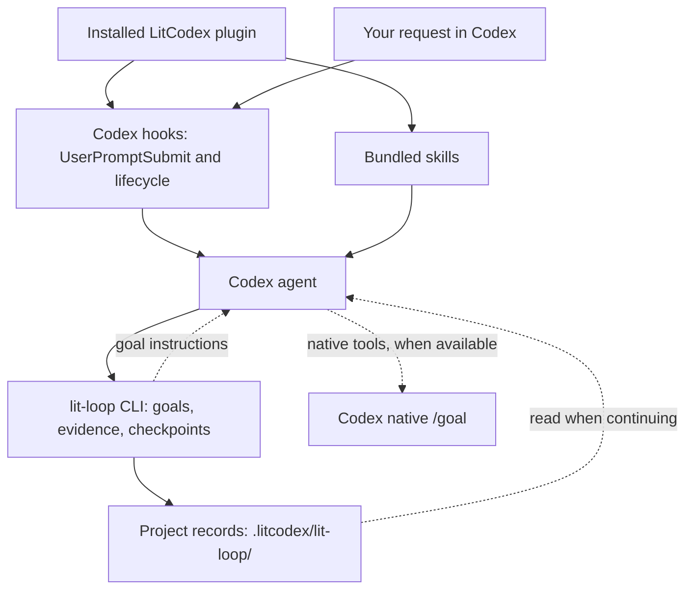

<p align="center"><picture><source media="(prefers-reduced-motion: reduce)" srcset="./docs/assets/cover-motion-still.webp" /></picture></p>

# LitCodex

**Keep the work lit.**

A plugin for Codex CLI that turns a request into a goal with checks, keeps the evidence in your project,
and hands unfinished work to the next session.

<p>
<a href="https://www.npmjs.com/package/@litfamily/litcodex"></a>
<a href="https://www.npmjs.com/package/@litfamily/litcodex"></a>
<a href="./LICENSE"></a>
<a href="https://github.com/wjgoarxiv/litcodex/stargazers"></a>
</p>

[한국어](./README-Ko-KR.md) · [Install](#install) · [First task](#start-with-lit) · [What you get](#what-you-get) · [Commands](#commands) · [Learn more](#learn-more)

<p><br /><sub>A real Codex 0.159 session with LitCodex 1.0.18, recorded in a terminal and replayed on a drawn terminal window with camera moves. Waiting time is shortened, the project folder is shown as ~/greet and a few labels are blurred; the rest is as Codex printed it.</sub></p> <!-- demo-gif -->

## What is LitCodex

Codex CLI is quick at the next step. The trouble starts when a piece of work is bigger than one
conversation. The context fills up or the session ends, and the next session has to work out again what
was decided, what was checked and what was left half done. Somewhere along the way, a change that nobody
actually verified gets called finished.

LitCodex is a plugin for Codex CLI that keeps that thread. Put `lit` in a request and it becomes a goal
with checks that can pass or fail. The goal counts as finished only when every check has recorded
evidence, and those records stay in your project, where any later session can read them. Send the single
word `handoff` before you stop, and the next session starts from a written note of where you were.

Around that loop come more than forty skills for planning, code review, research, debugging, Word and
PowerPoint files, and English or Korean prose. The work runs inside Codex on your machine, with your
own sign-in and models.

## Install

You need Node.js 22 or later and Codex CLI. Then run:

```sh
npm exec --yes --package @litfamily/litcodex@1.0.19 -- litcodex install
```

The installer asks three questions: which model leads, which model helps, and which output style you
like. Pressing Enter keeps the recommended models and your current output style. It then shows the route it is about to
write and waits for one more Enter before it touches anything. It registers the plugin, its hooks and its
agent roles, and it changes only the keys it manages in `~/.codex/config.toml`. When the receipt says
`Status Ready for Codex`, the doctor check has already passed.

To see the plan first, run `npm exec --yes --package @litfamily/litcodex@1.0.19 -- litcodex --dry-run install`;
it prints every step and writes nothing. To keep the defaults without any questions, add `--yes` after `install`.

If you would rather have `litcodex` on your `PATH`:

```sh
npm install -g @litfamily/litcodex
litcodex install
```

A global install also gets the video skill's rendering tools ready ahead of time, which means a few
pinned downloads. The [install guide](./docs/install.md#a-global-command) lists them and shows how to skip
them.

> Without a global install, use `npm exec --yes --package @litfamily/litcodex@1.0.19 -- litcodex <command>`, such as `npm exec --yes --package @litfamily/litcodex@1.0.19 -- litcodex doctor`.

The [install guide](./docs/install.md) also covers trying LitCodex in a home of its own, Windows, and
pictures of every screen the installer shows. Coming from the old unscoped package? The
[migration guide](./docs/npm-migration.md) covers the move.

## Start with lit

Open Codex in your project. The first time, Codex asks you to review the LitCodex hooks; approve them.
Then type:

```text
lit add input validation to the signup form
```

The hook answers before the model does. A five-row LIT mark appears, sent by the `UserPromptSubmit` hook
as plain text, and the reply opens with `🔥 **LIT IGNITED · <discipline>** 🔥`. From there the request
runs in the work loop (`<lit-loop-mode>` internally): a goal, its checks, and evidence recorded as each
check passes.

`lit` has to stand on its own as a word. Words that only contain the letters, such as `split`, `literal`
or `litmus`, do nothing, and neither does `lit` inside a code span or a code block.
Slash commands are left alone as well, with one exception: `/litresearch` starts research.

`handoff` and `lit-scientific-visualization` are exact-only routes: each works only when it is the whole
message. Send exact bare `handoff` to write a continuation packet before you leave a session. Send exact
bare `lit-scientific-visualization` to switch to plotting mode (`<lit-scientific-visualization-mode>`);
it installs no Python packages.

### Make one small thing

For a first run you can judge yourself, try this in an empty folder:

```text
lit build a single-file HTML task list in this folder. Do not install dependencies.
Check adding and completing a task, and record anything you could not verify.
```

When it finishes, look at three things: the page itself (open it and add a task), the checks that
actually ran, and what is still open. `lit recap` reads back what was recorded. Send `handoff` on its own
before you close the session, and in the next one ask Codex to read that packet and the project goals
first.

## What you get

**Work that finishes for real.** `lit` turns a request into a goal with checks. A goal can be completed
only once every check has passing evidence, and anything Codex could not verify is written down where
you will see it.

```text
lit fix the flaky login test and show me the run that proves it
```

**A plan before the edits.** `lit plan` writes a plan with numbered steps and success criteria into
`.litcodex/plans/` and edits nothing else. Once you approve it, `lit start work <plan-name>` runs each step
through five gates (re-read, automated checks, manual QA, adversarial QA, cleanup) and finishes only after
all five review lanes pass.

```text
lit plan move the settings page to the new form library
```

**Reviews that can say no.** `lit review` runs five separate reviews of a plan or a finished change, and
any one of them can hold back approval.

**Research with sources.** `lit research` gathers evidence in parallel and writes a cited synthesis that
keeps facts, hypotheses and open questions apart.

```text
lit research which Node 22 OAuth libraries support PKCE, with sources
```

**Word and PowerPoint files.** Ask for a report or slides with `lit` and the matching skill (`lit-docx`
or `lit-pptx`) reads your material, picks a design direction, names it with two alternatives, and builds
an editable file with its Markdown source next to it.

```text
lit turn notes.md into a ten-slide deck for the Monday review
```

**Cleaner prose, in English or Korean.** `$litcodex:lit-humanizer` rewrites stiff model writing while
keeping facts and hedges. Before a file is written, its hook stops a few clear drafting tells.

### Also in the box

Every skill can be picked in the Codex skill picker or mentioned by name, such as `$litcodex:debugging`.
[The skills page](./docs/skills.md) has a picture and a one-line description for each.

| For | Skills |
| --- | --- |
| Code | `debugging`, `refactor`, `lit-code`, `lit-commit`, `lit-burnoff`, `lit-burnoff-file`, `structural-search`, `lsp-setup`, `lit-init` |
| Planning and teams | `deep-interview`, `lit-crucible`, `litgoal`, `litwork`, `lit-team` |
| Research and knowledge | `autoresearch`, `autoconference`, `wikify`, `lit-fetch`, `coding-session-audit`, `lit-comprehend` |
| Screens, figures and film | `frontend-ui-ux`, `visual-qa`, `browser-drive`, `readme-studio`, `lit-diagram-drawer`, `lit-scientific-visualization`, `lit-typographic-motion` |
| Keeping LitCodex healthy | `litcodex-doctor`, `litcodex-report-bug`, `litcodex-contribute-bug-fix` |
| Running on their own | `rules`, `lsp` and `comment-checker`: project rules on each prompt, LSP and comment checks after edits |

## How it works

Codex hosts the plugin and runs its hooks. The hooks work out which mode a request belongs to and add
context; the skills tell the agent how to do the work. The loop CLI keeps the project records and prints
instructions for Codex's native goal tools.



The dotted line to Codex's goal tools is an instruction the agent follows when those tools are there;
LitCodex itself never calls them. Sign-in, model access, permissions and every run happen in Codex on
your machine, so judge a piece of work by what it produced and which checks ran. The
[usage reference](./docs/usage.md) goes deeper.

## Commands

### In the Codex composer

| Type this | Mode | What it does |
| --- | --- | --- |
| `lit` or `lit-loop` | **lit-loop** | Runs the work in a durable loop and checkpoints the evidence |
| `litwork` | **litwork** | Outcome-first work, backed by manual QA evidence |
| `lit-plan` or `lit plan` | **lit-plan** | Planning only: a bounded plan with evidence and a final done claim |
| `deep-interview` or `lit deep interview` | **deep-interview** | Planning only: asks questions until a vague brief is clear |
| `litgoal` or `lit goal` | **litgoal** | Binds an objective and its criteria into the loop state |
| `lit-recap` or `lit recap` | **lit-recap** | A read-only recap from the `.litcodex` ledgers |
| `lit-comprehend` or `comprehend` | **lit-comprehend** | Builds a self-contained explainer outside the worktree |
| `review-work` or `lit review` | **review-work** | A read-only review of a plan or of finished work |
| `litresearch`, `/litresearch`, or `lit research` | **litresearch** | A research journal that keeps facts, hypotheses, sources and uncertainty apart |
| `lit start work <plan-name>` | **Start Work** | Runs an approved plan and keeps its evidence |
| exact bare `handoff` | **lit-handoff** | Creates or refreshes a continuation packet that leaves secrets out |
| exact bare `lit-scientific-visualization` | **lit-scientific-visualization** | Loads the publication plotting adapter through the hook |

Typing the same mode again in one session has no extra effect.

### CLI commands

| Command | What it does |
| --- | --- |
| `litcodex install` | Registers the LitCodex plugin and hook |
| `litcodex doctor` | Diagnoses the install, loop state, host capabilities and effective config |
| `litcodex uninstall` | Removes the plugin and the config LitCodex manages |
| `litcodex config migrate` | Previews or applies the managed Codex config keys |
| `litcodex office-runtime install` or `status` | Prepares or checks the pinned tools for Word and PowerPoint files |
| `litcodex motion-runtime install` or `status` | Prepares or checks the film renderer tools |
| `litcodex loop create` | Derives goals and criteria from a brief |
| `litcodex loop status --json` | Shows the loop state as JSON |
| `litcodex loop run` | Picks the next goal that can run |
| `litcodex loop record-evidence` | Records a pass, fail or blocked result for one criterion |
| `litcodex loop checkpoint` | Completes a goal, but only when every criterion passes |
| `litcodex loop doctor` | Diagnoses or recovers the loop state |

## Where your work is kept

A project's loop state lives under `.litcodex/lit-loop/`: `brief.md`, `goals.json`, `ledger.jsonl` and the
`evidence/` folder. Each write lands whole or not at all, and if the goals file is ever damaged, it is
kept as `.bak` so you can recover it. The state stays on your machine, out of Git and out of packages.
See [state and recovery](./docs/usage.md#loop-state).

## Check the install

```sh
npm exec --yes --package @litfamily/litcodex@1.0.19 -- litcodex doctor
```

`litcodex doctor` checks registration, hooks, config and host capabilities, and a clean run ends with
All checks passed. `litcodex loop doctor` checks the loop state of the current project. Both look at the
setup; to see signed-in model work and child agents actually run, give Codex a small real task.

Codex draws its own status line and terminal title, and a plugin cannot add to them. When every check
passes and your config has no status line or title, doctor suggests a `[tui]` block to paste: model
and reasoning, context used, the five-hour and weekly limits, task progress and the Git branch below
the prompt, and the activity spinner with the project name in the window title. You can also pick items inside Codex with `/statusline` and `/title`.
Doctor only prints the suggestion and never edits your config.

## Updates

With the `npm exec` form, run the install command again with the newer version number. A global install
can update itself after an interactive command, and an interactive `litcodex doctor` may mention a newer
version. Set `LITCODEX_NO_UPDATE_CHECK=1` to turn both off. Details are in
[privacy](./docs/privacy.md#registry-traffic-and-updates).

## Troubleshooting

- **The terminal window closes right away.** Open a terminal that stays open, run help, install and
  doctor one at a time, and note each exit code. Then follow the [staged trial](./docs/npm-migration.md#isolated-local-trial) and
  start Codex yourself.
- **Nothing activates.** Run `litcodex doctor` and check that the hooks are approved in Codex.
- **The command is missing.** Use the `npm exec` form above, or check that npm's global bin directory is on
  your `PATH`.
- **A native goal is paused or blocked.** Run `/goal resume`, confirm the goal is active, then retry with
  `litcodex loop run --retry-failed`. Keep the unfinished goal. [Recovery details](./docs/usage.md#troubleshooting).

## Uninstall

```sh
npm exec --yes --package @litfamily/litcodex@1.0.19 -- litcodex uninstall
```

`litcodex uninstall` removes the plugin and the config LitCodex manages, and leaves your other settings alone.

## Learn more

- [Install guide](./docs/install.md): every install variant, what a global install downloads, Windows,
  pictures of each installer screen, and what installing will and will not change.
- [Skills](./docs/skills.md): every bundled skill with a picture, and which ones are worth knowing by name.
- [Automatic handoff](./docs/auto-handoff.md): writes the handoff for you when the context reaches a
  percent you choose. Off by default.
- [Jev skill hint](./docs/jev-skill-hint.md): an optional skill suggestion from a hosted model. Turning it
  on sends prompts to a third party, so read this page first. Off by default.
- [Usage reference](./docs/usage.md): every route, model configuration, platform limits and recovery.
- [Privacy and network behavior](./docs/privacy.md) and the [migration guide](./docs/npm-migration.md).
- [Media and brand](./docs/media.md): the films, the logo and the story behind the name.
- For contributors: the [LitCodex contract](./docs/spec/litcodex-contract.md), the
  [reference analysis](./docs/reference-analysis.md), [release provenance](./docs/release/provenance.md),
  the [publish checklist](./docs/release/publish-checklist.md) and [CHANGELOG.md](./CHANGELOG.md). Tests, fixtures,
  test helpers and the Vitest configuration live only in this repository. Neither the npm package nor the
  installed marketplace plugin includes them.
- [The LitFamily hub](https://github.com/wjgoarxiv/litfamily): the same lit workflow for other coding agents.

If LitCodex saves you from explaining the same project twice, a star helps other Codex users find it.

[Contributing](./CONTRIBUTING.md) · [Security](./SECURITY.md) · [Code of conduct](./CODE_OF_CONDUCT.md) · [Support](./SUPPORT.md)

## License

[MIT](./LICENSE)
