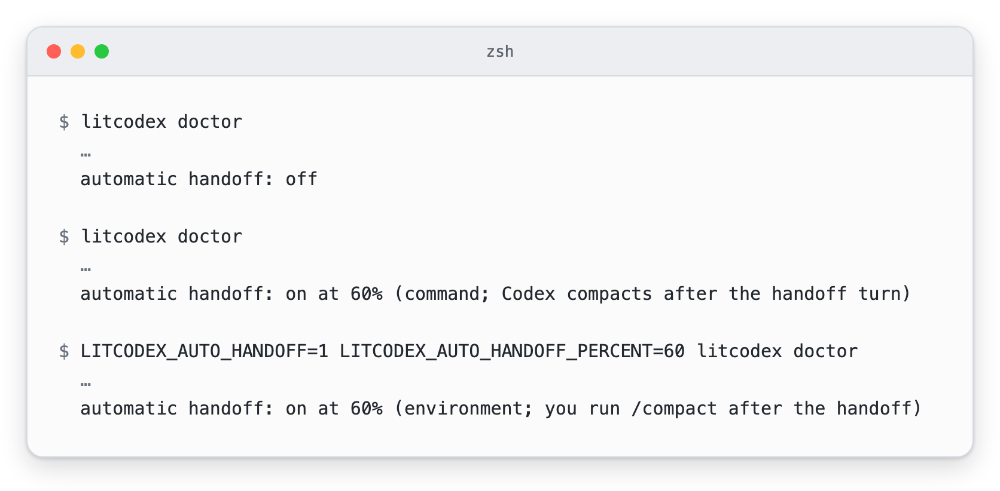

# Automatic handoff (optional)

[README](../README.md) · [한국어](./auto-handoff-Ko-KR.md)

A long session eventually runs out of room, and the next context starts without what this one learned. A
handoff file carries that knowledge across. This option writes the handoff for you when the conversation
reaches a size you choose, so you never have to watch the context meter.

It is off until you turn it on, and you choose the percent of the context window at which it acts. LitCodex
has no default percent. Once the conversation reaches your percent, the Stop hook has the model save a handoff
and start no other work in that turn. The conversation is then compacted, by Codex itself or by you with
`/compact`, and the next context opens with the handoff that was just saved.

## Turn it on

Send this as your whole prompt. 60 is only an example; any whole number from 1 to 99 works:

```text
lit-handoff auto on 60
```

LitCodex answers at once, and the prompt never reaches the model. Codex shows the reply under "Blocked by
hook", which is how it displays a prompt that a hook answered by itself.

<p><picture><source media="(prefers-color-scheme: dark)" srcset="./assets/auto-handoff/auto-handoff-on-dark.webp" /></picture></p>

The command also writes your percent into the project's `.codex/config.toml`, as a marked block at the top of
the file:

```toml
# litcodex automatic handoff (managed by `lit-handoff auto`; `lit-handoff auto off` removes it)
model_post_turn_compact_threshold_percent = 60
```

That key tells Codex to compact as soon as a turn ends at or above 60%, so the turn that saved the handoff is
followed by the compaction without you typing anything. It needs Codex CLI 0.158 or newer, and Codex reads a
project's own `.codex/config.toml` only after you trust the project. LitCodex checks that trust in your Codex
config, and in a project you have not trusted yet the reply ends differently: "Codex reads the project
.codex/config.toml only after you trust this project, so until then you will be asked to run /compact yourself."
When the project file already sets that key by hand, LitCodex leaves your line alone and says so in the reply.

## Check it and turn it off

`lit-handoff auto status` tells you what is set, where the setting came from and how the compaction will
happen. `lit-handoff auto off` turns the option off and keeps your number for next time; sending
`lit-handoff auto on` with no number later brings that number back.

<p><picture><source media="(prefers-color-scheme: dark)" srcset="./assets/auto-handoff/auto-handoff-status-off-dark.webp" /></picture></p>

Turning it off removes only the marked block from `.codex/config.toml`, and the file goes away when nothing else
was in it. The same cleanup happens when the option ends up off some other way, such as
`LITCODEX_AUTO_HANDOFF=0` or a deleted settings file: the next hook run or `lit-handoff auto` prompt removes the
block, and `litcodex doctor` warns while it is still there.

If you send `lit-handoff auto on` before you have ever chosen a number, LitCodex asks for one. A number outside
1 to 99, or one that is not a whole number, changes nothing, and any other words after `lit-handoff auto` get the
usage line back.

## When the conversation reaches your percent

Each time a turn ends, the Stop hook reads how much of the context window the last model request used. That is
the same number Codex compares with its own compaction setting, so the two agree on when the line is crossed.

At or above your percent, the hook holds the turn open and asks the model to save the handoff now with the
lit-handoff skill, add a line `Auto-handoff session: <session id>` so the next context can find this session's
file, read the file back, and then tell you one plain line. The model starts no other work in that turn. The hook
asks once per crossing, and asks again only after the context has dropped below your percent and climbed back.

The line you see depends on who compacts. When Codex will compact by itself, it reads "Handoff saved. Codex
compacts the conversation next." Otherwise it reads "Handoff saved. Run /compact now.", and you type `/compact`.

<p><picture><source media="(prefers-color-scheme: dark)" srcset="./assets/auto-handoff/auto-handoff-saved-dark.webp" /></picture></p>

After the compaction, LitCodex gives the model the opening of the handoff this session just saved, with its path,
once, and asks it to read the whole file before it continues. A handoff written before the trigger, or one that
names another session, is left out.

Choose a percent below the point where Codex compacts on its own. Otherwise Codex can compact before the handoff
is saved, and `litcodex doctor` warns when your percent reaches that point.

## Use environment variables instead

If you would rather set it per shell, start Codex with both variables:

```sh
LITCODEX_AUTO_HANDOFF=1 LITCODEX_AUTO_HANDOFF_PERCENT=60 codex
```

While they are set they take priority over the command, and `lit-handoff auto on` says so in its reply.
`LITCODEX_AUTO_HANDOFF=0` turns the option off. The environment never writes the project's `.codex/config.toml`,
so unless that file already asks Codex to compact, you run `/compact` yourself after the handoff. A percent outside
1 to 99, or one that is not a whole number, leaves the option off, and `litcodex doctor` says why.

## Check it from the shell

`litcodex doctor` prints one `automatic handoff` line that matches what the prompts report. Below are three runs
in the same project: before the option was turned on, after `lit-handoff auto on 60` in a trusted project, and
with the environment variables after it was turned off again.

<p><picture><source media="(prefers-color-scheme: dark)" srcset="./assets/auto-handoff/auto-handoff-doctor-dark.webp" /></picture></p>

Doctor also warns when your percent sits at or above Codex's own compaction point, when the project file
compacts below your percent, and when a marked block is left over after the option was turned off.

Your choice and the per-session records live in `.litcodex/auto-handoff/` inside the project, on your machine and
out of Git. See [privacy](./privacy.md#automatic-handoff). The pictures and how they were made are listed in the
[media notes](./assets/auto-handoff/README.md).
