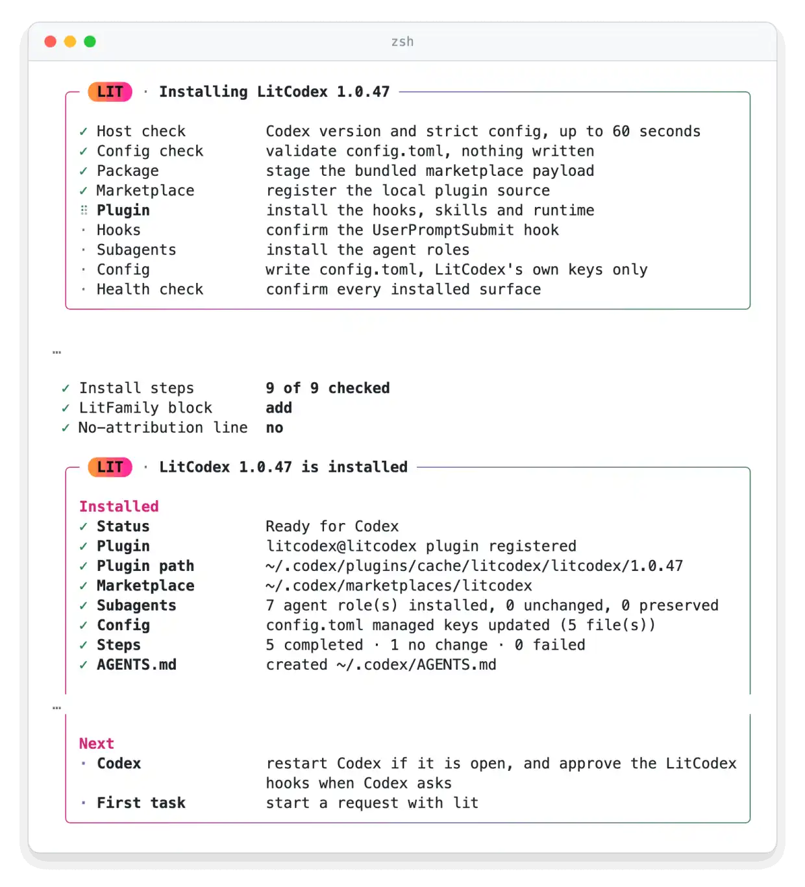
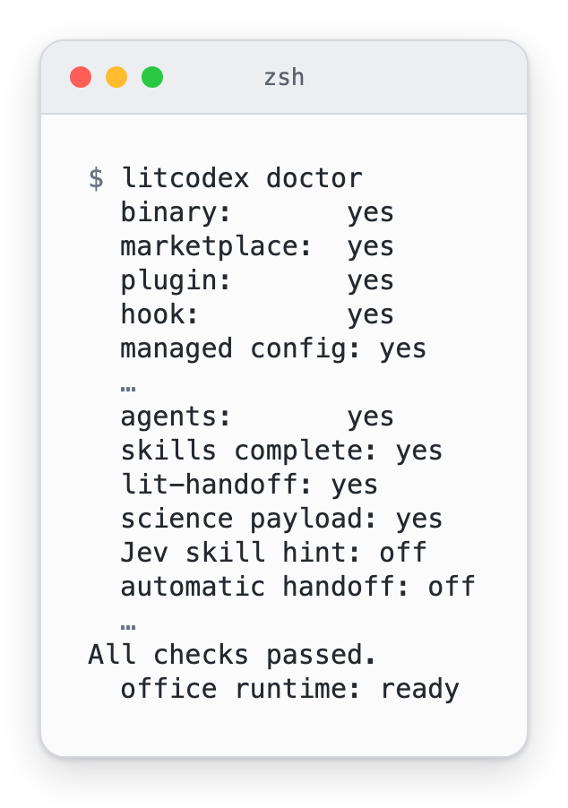
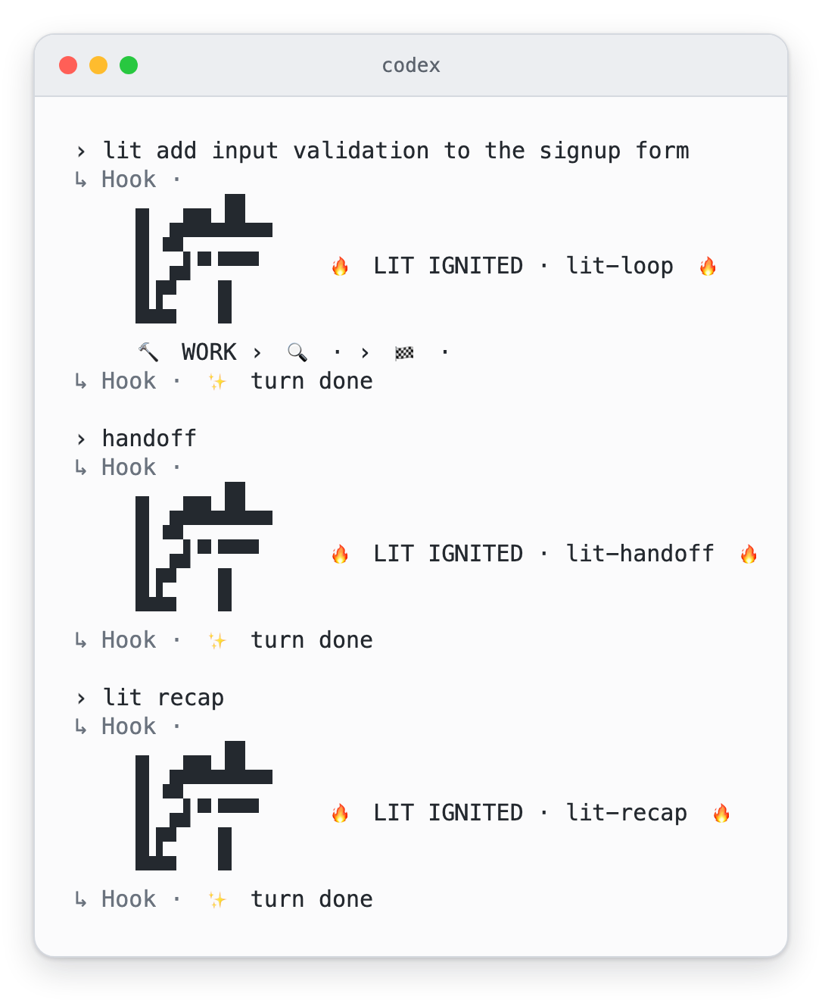

# LitCodex 설치 안내

[README](../README-Ko-KR.md) · [English](./install.md)

설치에 관한 내용을 이 문서에 모았습니다. 설치 방식별 차이, 전역 설치 때 받는 파일, 기존 설정과 떼어 놓고 써 보는 법, 설치기가 화면에 보여 주는 내용, 설치가 건드리는 곳과 건드리지 않는 곳을 다룹니다. 짧은 안내는 [README](../README-Ko-KR.md#설치)에 있습니다.

## 설치

Node.js 22 이상과 Codex CLI가 있으면 아래 명령 하나로 설치합니다.

```sh
npm exec --yes --package @litfamily/litcodex@1.0.47 -- litcodex install
```

설치기는 Codex 안에 LitCodex 자리를 만듭니다. 플러그인과 훅, 에이전트를 등록하고,
`~/.codex/config.toml`에서는 자기가 관리하는 항목만 고칩니다. 설치 중에 세 가지를 묻습니다. 어떤 모델이
작업을 이끌지, 어떤 모델이 거들지, 답변을 어떤 스타일로 받을지입니다. 설치 자체가 끝나면 한 가지를 더 묻습니다.
전역 `~/.codex/AGENTS.md`에 짧은 LitFamily 블록을 넣을지입니다. 예라고 하면 쓰고, 아니오라면 파일을 그대로 두고
꺼짐으로 기억하고, `install --yes`는 예로 답하고, `--no-agent-file`은 건너뜁니다. 예라고 했고 전에 정해 둔 적이 없으면
AI 저작 표시를 넣지 말라는 한 줄도 블록에 넣을지 마지막으로 묻습니다. 새로 설치하면 이끄는 쪽(리드)은
`gpt-6-astra`/`xhigh`, 일반 헬퍼는 `gpt-6-luna`/`max`로 시작하고, 지원되는 다른 모델과 추론 수준으로 바꿔도 됩니다.

필요한 것은 npm 패키지에 다 들어 있어서 저장소를 복제할 일도, GitHub에 로그인할 일도 없습니다.
Codex 로그인과 모델 사용 권한은 실제 모델 작업을 시작할 때 필요합니다.

알아 두면 좋은 변형이 두 가지 있습니다.

- 설치 전에 무엇이 바뀌는지 먼저 보고 싶다면 `npm exec --yes --package @litfamily/litcodex@1.0.47 -- litcodex --dry-run install`을 실행하세요.
- 사람이 지켜보지 않는 환경에서 한 번에 설치하려면 `npm exec --yes --package @litfamily/litcodex@1.0.47 -- litcodex install --yes`를 실행하세요. 직접 넘긴 `--style <id>`는 그대로 반영됩니다.

실행하기 전에 설치기가 무엇을 출력하는지 보고 싶다면 [설치부터 첫 작업까지 보이는 화면](#설치부터-첫-작업까지-보이는-화면)에 질문 화면과 영수증, doctor 검사가 있습니다.

예전 패키지 이름(`litcodex-ai`)으로 설치했다면 [기존 설치 이전 안내](./npm-migration.md)를 먼저 읽어 주세요.

### 전역 명령으로 쓰기

`litcodex`를 `PATH`에서 바로 부르고 싶다면 다음을 실행합니다.

```sh
npm install -g @litfamily/litcodex
litcodex install
```

전역으로 설치하면 짧은 설치 스크립트도 함께 돕니다. `CI`가 설정되어 있지 않으면 환영 문구와 다음 단계를
보여 주고, 아무것도 내려받지 않습니다. 빼고 싶다면 `npm install -g`에 `--ignore-scripts`를 붙이거나 그 명령에만
`CI=1`을 설정하세요.

> 전역 설치가 없다면 `npm exec --yes --package @litfamily/litcodex@1.0.47 -- litcodex <command>` 형식을 사용하세요. 예: `npm exec --yes --package @litfamily/litcodex@1.0.47 -- litcodex doctor`.

### 기존 설정과 떼어 놓고 써 보기

지금 쓰는 설정을 건드리지 않고 체험하려면 [격리된 체험 안내](./npm-migration.md#isolated-local-trial)를 따르세요.
이 안내는 체험용 홈 디렉터리를 통째로 따로 만듭니다. `CODEX_HOME` 하나만 바꾸면 기존 홈의 설정이 여전히 읽힐 수 있기 때문입니다.

### Windows

Windows에서도 설치기와 CLI shim은 동작합니다. 다만 POSIX 디렉터리 디스크립터를 쓰는 Python 경로는
Windows에서 돌 수 없어서 `BLOCKED_UNSUPPORTED_PYTHON_POSIX_RUNTIME`으로 멈춥니다. 자세한 내용은
[플랫폼·질문 정책](./usage-Ko-KR.md#설치)에 있습니다.

## 설치부터 첫 작업까지 보이는 화면

설치부터 첫 작업까지 LitCodex가 무엇을 출력하는지 사진 다섯 장으로 보여 줍니다. 모두 임시 홈에서 실제 프로그램을 실행해 캡처했고,
사진을 짧게 하려고 뺀 줄은 사진마다 설명에 적었습니다. 사진은 Codex CLI 0.162와 0.163에서 만들었으며, Codex 버전에 따라 훅 줄의 표현이나
위치가 조금 다를 수 있습니다.

대화형으로 실행하면 설치기가 세 가지를 묻습니다. 어떤 모델이 이끌지, 어떤 모델이 거들지, 답변을 어떤 스타일로 받을지입니다.
질문마다 카드가 하나씩 나옵니다. 방향키로 옮기거나 줄 번호를 치고 Enter를 누르세요. Enter만 누르면 강조된 기본값이
골라집니다. 권장 모델과 현재 출력 스타일입니다. 답한 카드는 한 줄로 접힙니다. 네 번째 카드는 설치기가 쓰려는 경로를
보여 주고, 거기서 Enter를 누르기 전까지는 아무것도 쓰지 않습니다. 설치 단계가 끝나면 전역 `~/.codex/AGENTS.md`에 짧은
LitFamily 블록을 넣을지 묻고, `y`와 `n`이나 방향키로 답합니다. 어느 카드에서든 Ctrl+C로 멈출 수 있고, Esc는 답으로 치지 않습니다.

카드는 가로 40칸, 세로 12줄 이상인 터미널에서 나옵니다. `NO_COLOR`를 켜면 색 없이 나오고, UTF-8이 아닌 로캘에서는 ASCII로
그립니다. 파이프, CI, `--yes`, `TERM=dumb`, 더 작은 창에서는 예전처럼 글자로만 묻고 출력합니다.

<p><picture><source media="(prefers-color-scheme: dark)" srcset="./assets/screens/screen-install-questions-dark.webp" /></picture><br /><sub>임시 홈에서 실제 litcodex install을 실행해 캡처했습니다. 시작 배너와 두 번째, 세 번째 카드는 뺐습니다. …는 뺀 자리입니다.</sub></p>

그 Enter 뒤에는 카드 하나에 검사와 단계가 끝나는 대로 한 줄씩 쌓입니다. 마켓플레이스와 플러그인 단계에는 Codex가 출력한 줄도
함께 나옵니다. 마지막은 영수증 카드입니다. 먼저 Status 줄을 보세요. Ready for Codex라고 나오면 플러그인, 훅, 에이전트 역할
일곱 개, 관리하는 설정 항목이 모두 자리를 잡았고 doctor 검사도 통과했다는 뜻입니다. 단계가 실패하면 빨간 카드가 코드와 이유,
다음에 할 일을 알려 줍니다.

<p><picture><source media="(prefers-color-scheme: dark)" srcset="./assets/screens/screen-install-receipt-dark.webp" /></picture><br /><sub>같은 설치에서 캡처했습니다. Marketplace와 Plugin 단계 아래 Codex가 출력한 줄, 영수증 카드의 Models와 Codex host 줄, 그 아래 확장 안내는 뺐습니다.</sub></p>

결과를 가장 빨리 확인하는 방법은 `litcodex doctor`입니다. 대부분의 줄이 yes 또는 no로 답하고, 이상이 없으면 All checks passed.로
끝납니다.

<p><picture><source media="(prefers-color-scheme: dark)" srcset="./assets/screens/screen-doctor-dark.webp" /></picture><br /><sub>설치 직후 같은 홈에서 실행한 litcodex doctor 출력입니다. 시작 배너, 모델 경로, 동시 실행, 업데이트 관련 줄, Codex 로그인이 없는 홈에서 나오는 경고, 상태 줄 제안, 영상 도구 줄은 뺐습니다.</sub></p>

`lit`으로 시작하는 요청을 입력하면 훅이 모델보다 먼저 답합니다. 5행짜리 LIT 마크와, 고른 경로의 이름을 적은 줄을 출력합니다.
`handoff`와 `lit adhd`에서도 같은 마크가 나오고 경로 이름만 달라서, 어떤 모드가 요청을 받았는지 한눈에 알 수 있습니다.

<p><picture><source media="(prefers-color-scheme: dark)" srcset="./assets/screens/screen-lit-ignited-dark.webp" /></picture><br /><sub>실제 Codex 0.162 세션에서 LitCodex 훅을 돌리고 모델 자리는 로컬 대역이 맡아 캡처했습니다. 그래서 컴퓨터 밖으로 나간 것은 없습니다. 시작 배너, 폴더 신뢰와 훅 검토 화면, 모델의 답변은 뺐습니다.</sub></p>

마크 뒤에서는 루프가 프로젝트 안에 점수를 적어 둡니다. 새 목표는 확인 기준 세 개에 통과 0개로 시작합니다. 결과를 기록할 때마다
숫자가 올라가고, 기준이 모두 통과하기 전에 목표를 끝내 달라고 하면 거절합니다.

<p><picture><source media="(prefers-color-scheme: dark)" srcset="./assets/screens/screen-loop-dark.webp" /></picture><br /><sub>빈 프로젝트에서 실제 loop 명령을 실행해 캡처했습니다. 긴 명령은 백슬래시로 나눠 한 화면에 맞췄고, 두 번째 증거 기록 명령의 출력은 뺐습니다. 사진과 만든 방법은 <a href="./assets/screens/README.md">미디어 안내</a>에 정리했습니다.</sub></p>

## 안전

- 계획과 증거는 언제든 열어 볼 수 있습니다. 성공 기준은 통과했다는 증거가 기록돼야 완료되고, 테스트 명령을
  돌리기만 한 것으로는 부족합니다.
- 설치해도 관련 없는 Codex 설정은 그대로입니다. `--reconfigure` 전에는 바뀔 내용을 먼저 확인하세요.
- doctor 진단은 Codex 설정, 설치 상태, 플러그인 상태를 바꾸지 않고 살펴보기만 합니다. 그 밖에 백그라운드에서 도는
  업데이트 기능이 두 가지 있고, 둘 다 끌 수 있습니다.
  - 업데이트 안내. 터미널에서 직접 실행해 성공적으로 끝난 doctor처럼 조건에 맞는 실행이면, 캐시해 둔 새 버전
    안내가 뜰 수 있습니다. 이 안내를 새로 유지하려고 백그라운드 작업이 정해진 레지스트리만 조회해
    `~/.litcodex/update-check.json`에 적어 둡니다. 이 작업은 아무것도 설치하지 않습니다.
  - 업데이트 실행기. 조건에 맞는 대화형 관리 명령 뒤에는 별도의 업데이트 실행기가 새 전역 패키지를 설치할 수 있습니다.

  둘 다 원하지 않으면 `LITCODEX_NO_UPDATE_CHECK=1`을 설정하세요. 실패했거나 `--json`·`--dry-run`으로 돌렸거나,
  비TTY·CI 환경이거나 이 설정으로 끈 doctor 실행은 부수 효과가 없습니다. [개인정보 안내](./privacy.md)를 참고하세요.
- 고른 모델은 설정 파일에 적히는 값입니다. 그 모델을 실제로 쓸 수 있는지, 실제로 도는지는 Codex와 사용자 계정에
  달려 있습니다. [모델 호환성](./usage-Ko-KR.md#설치)을 참고하세요.
