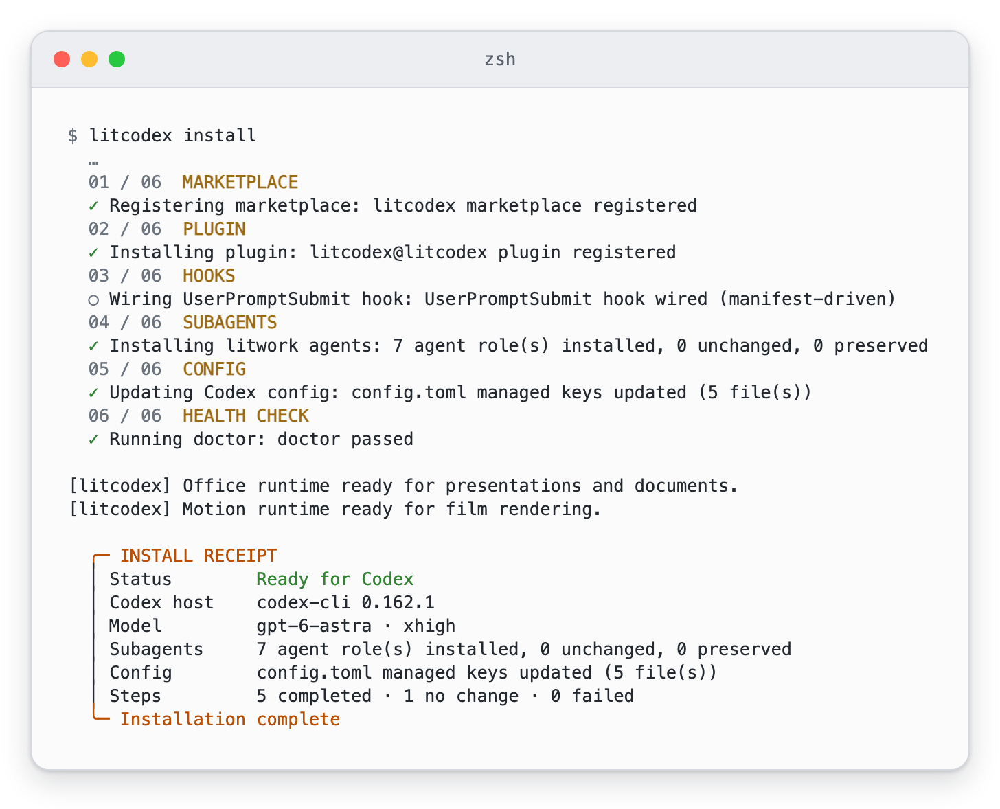
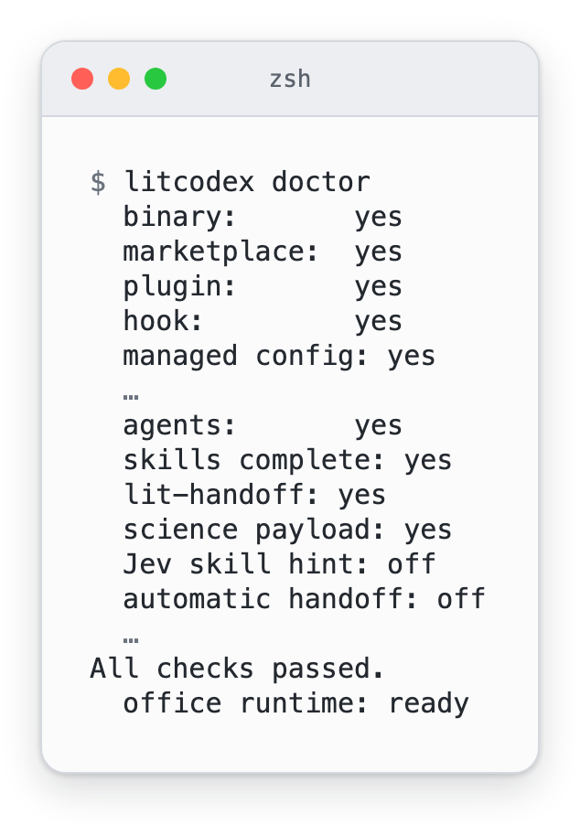
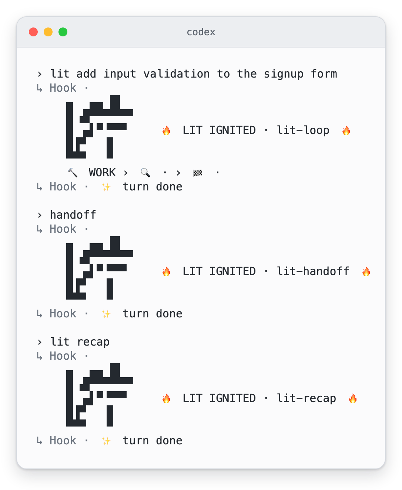

# LitCodex 설치 안내

[README](../README-Ko-KR.md) · [English](./install.md)

설치에 관한 내용을 이 문서에 모았습니다. 설치 방식별 차이, 전역 설치 때 받는 파일, 기존 설정과 떼어 놓고 써 보는 법, 설치기가 화면에 보여 주는 내용, 설치가 건드리는 곳과 건드리지 않는 곳을 다룹니다. 짧은 안내는 [README](../README-Ko-KR.md#설치)에 있습니다.

## 설치

Node.js 22 이상과 Codex CLI가 있으면 아래 명령 하나로 설치합니다.

```sh
npm exec --yes --package @litfamily/litcodex@1.0.27 -- litcodex install
```

설치기는 Codex 안에 LitCodex 자리를 만듭니다. 플러그인과 훅, 에이전트를 등록하고,
`~/.codex/config.toml`에서는 자기가 관리하는 항목만 고칩니다. 설치 중에 세 가지를 묻습니다. 어떤 모델이
작업을 이끌지, 어떤 모델이 거들지, 답변을 어떤 스타일로 받을지입니다. 새로 설치하면 이끄는 쪽(리드)은
`gpt-6-astra`/`xhigh`, 일반 헬퍼는 `gpt-6-luna`/`max`로 시작하고, 지원되는 다른 모델과 추론 수준으로 바꿔도 됩니다.

필요한 것은 npm 패키지에 다 들어 있어서 저장소를 복제할 일도, GitHub에 로그인할 일도 없습니다.
Codex 로그인과 모델 사용 권한은 실제 모델 작업을 시작할 때 필요합니다.

알아 두면 좋은 변형이 두 가지 있습니다.

- 설치 전에 무엇이 바뀌는지 먼저 보고 싶다면 `npm exec --yes --package @litfamily/litcodex@1.0.27 -- litcodex --dry-run install`을 실행하세요.
- 사람이 지켜보지 않는 환경에서 한 번에 설치하려면 `npm exec --yes --package @litfamily/litcodex@1.0.27 -- litcodex install --yes`를 실행하세요. 직접 넘긴 `--style <id>`는 그대로 반영됩니다.

실행하기 전에 설치기가 무엇을 출력하는지 보고 싶다면 [설치부터 첫 작업까지 보이는 화면](#설치부터-첫-작업까지-보이는-화면)에 질문 화면과 영수증, doctor 검사가 있습니다.

예전 패키지 이름(`litcodex-ai`)으로 설치했다면 [기존 설치 이전 안내](./npm-migration.md)를 먼저 읽어 주세요.

### 전역 명령으로 쓰기

`litcodex`를 `PATH`에서 바로 부르고 싶다면 다음을 실행합니다.

```sh
npm install -g @litfamily/litcodex
litcodex install
```

전역으로 설치하면 파일 복사로 끝나지 않습니다. `CI`가 설정되어 있지 않으면 내려받기가 끝난 뒤 짧은 설치
스크립트가 환영 문구를 보여 주고, 영상 스킬 `lit-typographic-motion`이 쓸 도구를 미리 받아 둡니다. 처음 영상을
요청할 때 렌더링 도구가 이미 준비되어 있게 하려는 것입니다.

미리 받아 두는 만큼 인터넷을 씁니다. 스크립트가 `npm ci`로 버전이 고정된 `opentype.js`, `playwright-core`, `ws`를
npm 레지스트리에서 받고, 역시 고정된 글꼴·라이선스 파일을 GitHub와 apache.org에서 받습니다. 브라우저는 받지
않습니다. 받은 것은 모두 `${XDG_CACHE_HOME:-~/.cache}/litcodex/motion-runtime/`에 들어갑니다. 이 단계가 끝나지
않아도 LitCodex 설치는 그대로 남고, 나중에 다시 해 볼 명령 `litcodex motion-runtime install`을 알려 줍니다.

전역 설치 때 이 스크립트를 빼고 싶다면 방법은 두 가지입니다.

- `npm install -g`에 `--ignore-scripts`를 붙이세요. 스크립트가 통째로 빠지고 환영 문구도 나오지 않습니다.
- 그 명령에만 `CI=1`을 설정하세요. 스크립트가 이 값을 보고 아무것도 하지 않은 채 끝납니다. `CI`가 원래
  설정된 빌드 서버에서 조용히 넘어가는 것과 같은 방식입니다.

여기서 빼면 내려받기가 뒤로 미뤄질 뿐입니다. `litcodex install`이 설치에 성공한 뒤 같은 방식으로 영상 도구를
준비하고, 이 단계는 끌 수 없습니다.

> 전역 설치가 없다면 `npm exec --yes --package @litfamily/litcodex@1.0.27 -- litcodex <command>` 형식을 사용하세요. 예: `npm exec --yes --package @litfamily/litcodex@1.0.27 -- litcodex doctor`.

### 기존 설정과 떼어 놓고 써 보기

지금 쓰는 설정을 건드리지 않고 체험하려면 [격리된 체험 안내](./npm-migration.md#isolated-local-trial)를 따르세요.
이 안내는 체험용 홈 디렉터리를 통째로 따로 만듭니다. `CODEX_HOME` 하나만 바꾸면 기존 홈의 설정이 여전히 읽힐 수 있기 때문입니다.

### Windows

Windows에서도 설치기와 CLI shim은 동작합니다. 다만 POSIX 디렉터리 디스크립터를 쓰는 Python 경로는
Windows에서 돌 수 없어서 `BLOCKED_UNSUPPORTED_PYTHON_POSIX_RUNTIME`으로 멈춥니다. 자세한 내용은
[플랫폼·질문 정책](./usage-Ko-KR.md#설치)에 있습니다.

## 설치부터 첫 작업까지 보이는 화면

설치부터 첫 작업까지 LitCodex가 무엇을 출력하는지 사진 다섯 장으로 보여 줍니다. 모두 임시 홈에서 실제 프로그램을 실행해 캡처했고,
사진을 짧게 하려고 뺀 줄은 사진마다 설명에 적었습니다. 사진은 Codex CLI 0.162에서 만들었으며, Codex 버전에 따라 훅 줄의 표현이나
위치가 조금 다를 수 있습니다.

대화형으로 실행하면 설치기가 세 가지를 묻습니다. 어떤 모델이 이끌지, 어떤 모델이 거들지, 답변을 어떤 스타일로 받을지입니다.
그때마다 Enter를 누르면 첫 번째 선택지가 골라집니다. 권장 모델과 현재 출력 스타일입니다. 이어서 설치기가 쓰려는 경로를 상자로 보여 주고, Enter를 한 번 더 누르기 전까지는
아무것도 쓰지 않습니다.

<p><picture><source media="(prefers-color-scheme: dark)" srcset="./assets/screens/screen-install-questions-dark.webp" /></picture><br /><sub>임시 홈에서 실제 litcodex install을 실행하고 질문마다 Enter로 답해 캡처했습니다. 시작 배너는 뺐고, 모델 목록은 각각 마흔 줄인데 처음 두 줄과 마지막 줄만 남겼고, 경로 줄도 뺐습니다. …는 뺀 자리입니다.</sub></p>

마지막 Enter 뒤에 설치기는 여섯 단계를 차례로 거치고 영수증을 출력합니다. 먼저 Status 줄을 보세요. Ready for Codex라고 나오면
플러그인, 훅, 에이전트 역할 일곱 개, 관리하는 설정 항목이 모두 자리를 잡았고 doctor 검사도 통과했다는 뜻입니다. 영수증 위의
두 줄은 설치가 미리 준비하는 Office 도구와 영상 도구의 상태입니다. 이 준비가 끝나지 않으면 그렇다고 알리고, 나중에 실행할
명령을 알려 줍니다.

<p><picture><source media="(prefers-color-scheme: dark)" srcset="./assets/screens/screen-install-receipt-dark.webp" /></picture><br /><sub>같은 설치에서 캡처했습니다. 단계마다 붙는 설명과 경로 줄, 01단계 앞의 호스트 확인 줄, 영수증의 여러 줄은 뺐습니다.</sub></p>

결과를 가장 빨리 확인하는 방법은 `litcodex doctor`입니다. 대부분의 줄이 yes 또는 no로 답하고, 이상이 없으면 All checks passed.로
끝납니다.

<p><picture><source media="(prefers-color-scheme: dark)" srcset="./assets/screens/screen-doctor-dark.webp" /></picture><br /><sub>설치 직후 같은 홈에서 실행한 litcodex doctor 출력입니다. 시작 배너, 모델 경로, 동시 실행, 업데이트 관련 줄, Codex 로그인이 없는 홈에서 나오는 경고, 상태 줄 제안, 영상 도구 줄은 뺐습니다.</sub></p>

`lit`으로 시작하는 요청을 입력하면 훅이 모델보다 먼저 답합니다. 5행짜리 LIT 마크와, 고른 경로의 이름을 적은 줄을 출력합니다.
`handoff`와 `lit recap`에서도 같은 마크가 나오고 경로 이름만 달라서, 어떤 모드가 요청을 받았는지 한눈에 알 수 있습니다.

<p><picture><source media="(prefers-color-scheme: dark)" srcset="./assets/screens/screen-lit-ignited-dark.webp" /></picture><br /><sub>실제 Codex 0.162 세션에서 LitCodex 훅을 돌리고 모델 자리는 로컬 대역이 맡아 캡처했습니다. 그래서 컴퓨터 밖으로 나간 것은 없습니다. 시작 배너, 폴더 신뢰와 훅 검토 화면, 모델의 답변은 뺐습니다.</sub></p>

마크 뒤에서는 루프가 프로젝트 안에 점수를 적어 둡니다. 새 목표는 확인 기준 세 개에 통과 0개로 시작합니다. 결과를 기록할 때마다
숫자가 올라가고, 기준이 모두 통과하기 전에 목표를 끝내 달라고 하면 거절합니다.

<p><picture><source media="(prefers-color-scheme: dark)" srcset="./assets/screens/screen-loop-dark.webp" /></picture><br /><sub>빈 프로젝트에서 실제 loop 명령을 실행해 캡처했습니다. 긴 명령은 백슬래시로 나눠 한 화면에 맞췄고, 두 번째 증거 기록 명령의 출력은 뺐습니다. 사진과 만든 방법은 <a href="./assets/screens/README.md">미디어 안내</a>에 정리했습니다.</sub></p>

## 안전

- 계획과 증거는 언제든 열어 볼 수 있습니다. 성공 기준은 통과했다는 증거가 기록돼야 완료되고, 테스트 명령을
  돌리기만 한 것으로는 부족합니다.
- 설치해도 관련 없는 Codex 설정은 그대로입니다. `--reconfigure` 전에는 바뀔 내용을 먼저 확인하세요.
- doctor 진단은 Codex 설정, 설치 상태, 플러그인 상태를 바꾸지 않고 살펴보기만 합니다. 그 밖에 백그라운드에서 도는
  업데이트 기능이 두 가지 있고, 둘 다 끌 수 있습니다.
  - 업데이트 안내. 터미널에서 직접 실행해 성공적으로 끝난 doctor처럼 조건에 맞는 실행이면, 캐시해 둔 새 버전
    안내가 뜰 수 있습니다. 이 안내를 새로 유지하려고 백그라운드 작업이 정해진 레지스트리만 조회해
    `~/.litcodex/update-check.json`에 적어 둡니다. 이 작업은 아무것도 설치하지 않습니다.
  - 업데이트 실행기. 조건에 맞는 대화형 관리 명령 뒤에는 별도의 업데이트 실행기가 새 전역 패키지를 설치할 수 있습니다.

  둘 다 원하지 않으면 `LITCODEX_NO_UPDATE_CHECK=1`을 설정하세요. 실패했거나 `--json`·`--dry-run`으로 돌렸거나,
  비TTY·CI 환경이거나 이 설정으로 끈 doctor 실행은 부수 효과가 없습니다. [개인정보 안내](./privacy.md)를 참고하세요.
- 고른 모델은 설정 파일에 적히는 값입니다. 그 모델을 실제로 쓸 수 있는지, 실제로 도는지는 Codex와 사용자 계정에
  달려 있습니다. [모델 호환성](./usage-Ko-KR.md#설치)을 참고하세요.
