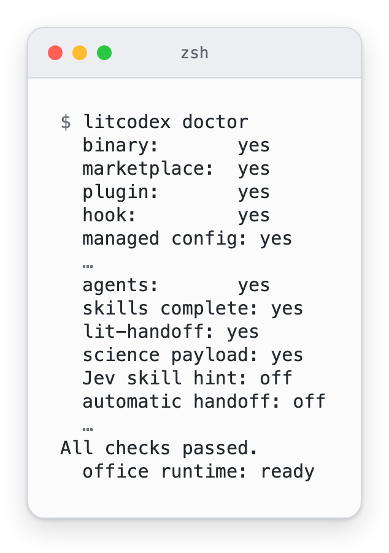
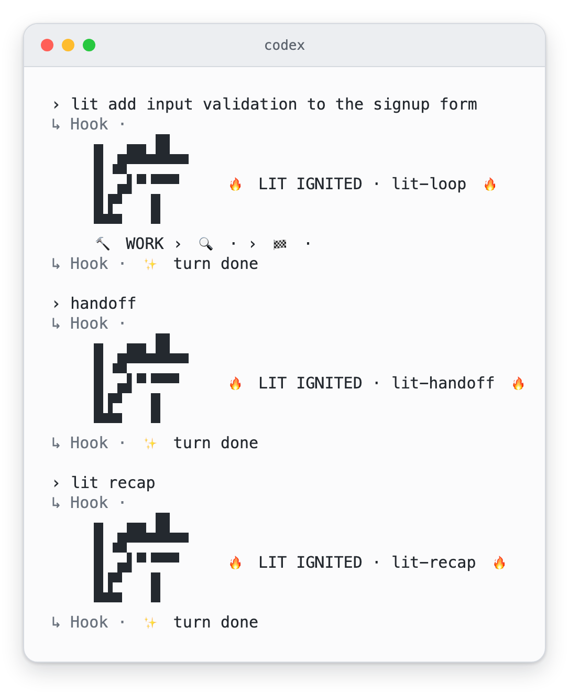

# Installing LitCodex

[README](../README.md) · [한국어](./install-Ko-KR.md)

This page has the whole install story: the variants, what a global install downloads, how to try LitCodex apart from your setup, what the installer prints, and what it will and will not touch. The [README](../README.md#install) has the short version.

## Install

You need Node.js 22 or later and Codex CLI. Then run:

```sh
npm exec --yes --package @litfamily/litcodex@1.0.47 -- litcodex install
```

The installer sets LitCodex up inside Codex. It registers the plugin, its hooks and its agents, and
it changes only the keys it manages in `~/.codex/config.toml`. Along the way it asks three questions:
which model leads, which model helps, and which output style you like. Once the install itself is done,
it asks one more: whether to add the short LitFamily block to the global `~/.codex/AGENTS.md` — yes writes
it, no leaves the file alone and remembers off, `install --yes` answers yes, and `--no-agent-file` skips it. If you
say yes and have not chosen before, a last question asks whether the block should also ask for no AI attribution.
On a fresh install the lead is
`gpt-6-astra` at `xhigh` and ordinary helpers use `gpt-6-luna` at `max`. Pick another supported model
and effort if you prefer.

Everything comes in the npm package, so there is nothing to clone and no GitHub sign-in. You need your
Codex sign-in and model access once real model work starts.

Two variants are worth knowing:

- If you want to see what would change before anything does, run `npm exec --yes --package @litfamily/litcodex@1.0.47 -- litcodex --dry-run install`.
- If you are setting up a machine without anyone at the keyboard, run `npm exec --yes --package @litfamily/litcodex@1.0.47 -- litcodex install --yes`. A `--style <id>` you pass is still used.

Want to see what the installer prints before you run it? [What you will see on screen](#what-you-will-see-on-screen) shows the questions, the receipt and the doctor check.

Coming from the old unscoped package? The [migration guide](./npm-migration.md) covers the move.

### A global command

If you would rather have `litcodex` on your `PATH`:

```sh
npm install -g @litfamily/litcodex
litcodex install
```

A global install also runs a short setup script. Unless `CI` is set, it prints a welcome with the next
steps. It downloads nothing. Add `--ignore-scripts` to `npm install -g`, or set `CI=1` for that one
command, to leave it out.

> Without a global install, use `npm exec --yes --package @litfamily/litcodex@1.0.47 -- litcodex <command>`, such as `npm exec --yes --package @litfamily/litcodex@1.0.47 -- litcodex doctor`.

### Trying it apart from your setup

To try LitCodex without touching your existing settings, follow the
[isolated trial guide](./npm-migration.md#isolated-local-trial). It gives the trial a whole home of its
own, because with only `CODEX_HOME` changed, settings in your existing home can still be found.

### Windows

The installer and the CLI shims work on Windows. Python routes that rely on POSIX directory
descriptors cannot run there, so on Windows they stop with `BLOCKED_UNSUPPORTED_PYTHON_POSIX_RUNTIME`. See [platform and prompt policy](./usage.md#install).

## What you will see on screen

Five pictures show what LitCodex prints, from the first install to your first task. Each one was captured from the
real program in a temporary home, and each caption says which lines were cut to keep the picture short. They come
from Codex CLI 0.162 and 0.163; other Codex versions may word or place hook lines a little differently.

Run interactively, the installer asks three questions: which model leads, which model helps, and which output style
you like. Each one is a card. Move with the arrow keys, or type a row's number, and press Enter; Enter alone keeps the
highlighted default: the recommended models and your current output style. Answered cards fold to one line each. The
fourth card lists the route the installer is about to write, and nothing is written until you press Enter there. After
the steps it asks about the short LitFamily block for the global `~/.codex/AGENTS.md`, with `y` and `n` or the arrow
keys. Ctrl+C stops at any card, and Esc never answers one.

The cards need a terminal at least 40 columns by 12 rows. `NO_COLOR` keeps them without color, and a locale without
UTF-8 draws them in plain ASCII. Pipes, CI, `--yes`, `TERM=dumb` and smaller windows keep the plain prompts and output.

<p><picture><source media="(prefers-color-scheme: dark)" srcset="./assets/screens/screen-install-questions-dark.webp" /></picture><br /><sub>Captured from a real litcodex install in a temporary home. The start banner and the second and third cards are cut; each … marks a cut.</sub></p>

After that Enter one card lists each check and step as it finishes, with the lines Codex itself printed under the
marketplace and plugin steps. The receipt card comes last. Start with the Status row: Ready for Codex means the plugin,
the hook, the seven agent roles and the managed config keys are in place and the doctor check passed. If a step fails,
a red card names the code, the reason and what to do next.

<p><picture><source media="(prefers-color-scheme: dark)" srcset="./assets/screens/screen-install-receipt-dark.webp" /></picture><br /><sub>Captured from the same install. The lines Codex printed under the Marketplace and Plugin steps, the Models and Codex host rows of the receipt card, and the extensions notice below it are cut.</sub></p>

`litcodex doctor` is the quickest way to check the result. Most rows answer yes or no, and a clean run ends with
All checks passed.

<p><picture><source media="(prefers-color-scheme: dark)" srcset="./assets/screens/screen-doctor-dark.webp" /></picture><br /><sub>Captured from litcodex doctor in the same home after the install. The start banner, the rows about model routes, concurrency and updates, the warnings that a home without a Codex sign-in produces, the status-line suggestion and the film-tool lines are cut.</sub></p>

Type a request that starts with `lit` and the hook answers before the model does. It prints the five-row LIT
mark and a line that names the route it picked. The same mark appears for `handoff` and `lit adhd`, each with its
own route name, so you can tell at a glance which mode took the request.

<p><picture><source media="(prefers-color-scheme: dark)" srcset="./assets/screens/screen-lit-ignited-dark.webp" /></picture><br /><sub>Captured from a real Codex 0.162 session with the LitCodex hooks and a local stand-in for the model, so nothing left the machine. The startup banner, the folder-trust and hook-review screens and the model replies are cut.</sub></p>

Behind the mark, the loop keeps score in your project. A new goal starts with three criteria and none passing. Each
recorded result moves the count, and a request to complete the goal early is refused until every criterion has
passed.

<p><picture><source media="(prefers-color-scheme: dark)" srcset="./assets/screens/screen-loop-dark.webp" /></picture><br /><sub>Captured from the real loop commands in an empty project. The long commands are split with backslashes to fit, and the output of the second evidence command is cut. The pictures and how they were made are listed in the <a href="./assets/screens/README.md">media notes</a>.</sub></p>

## Safety

- Plans and evidence stay where you can read them. A criterion is met by recorded evidence that it
  passed; simply running a test command does not count.
- Installing leaves your unrelated Codex settings as they are. Look at the planned changes before you
  use `--reconfigure`.
- Doctor only looks: the doctor diagnostic core never modifies your Codex config, install state or
  plugin state. There are two small update helpers around it, and you can switch both off.
  - The update notice. An eligible interactive doctor run (a successful run you start by hand in a terminal) may show
    a cached advisory notice about a newer version. To keep that notice fresh, a detached background
    worker does a fixed registry refresh and saves the answer in `~/.litcodex/update-check.json`. It
    never installs anything.
  - The updater. After an eligible interactive management command, a separate foreground updater can
    install a newer global package.

  Set `LITCODEX_NO_UPDATE_CHECK=1` if you want neither. A doctor run that failed, or ran with `--json`,
  `--dry-run`, in a non-TTY or CI shell, or with that opt-out set, stays side-effect-free. See
  [privacy](./privacy.md).
- The model you pick is a setting in your config. Whether that model is open to you, and whether it
  actually runs, is up to Codex and your account. See [managed model compatibility](./usage.md#safety).
