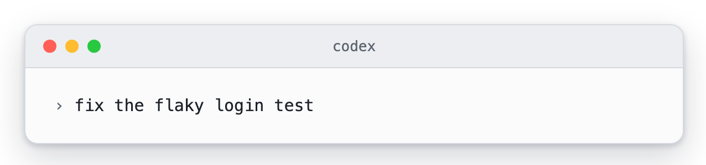
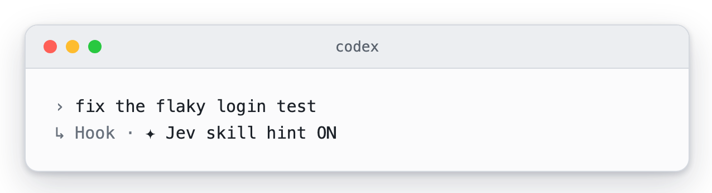
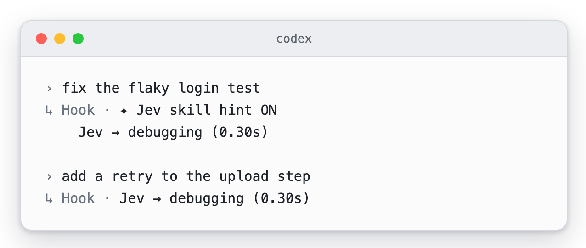
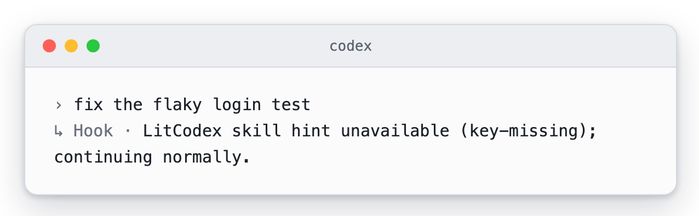
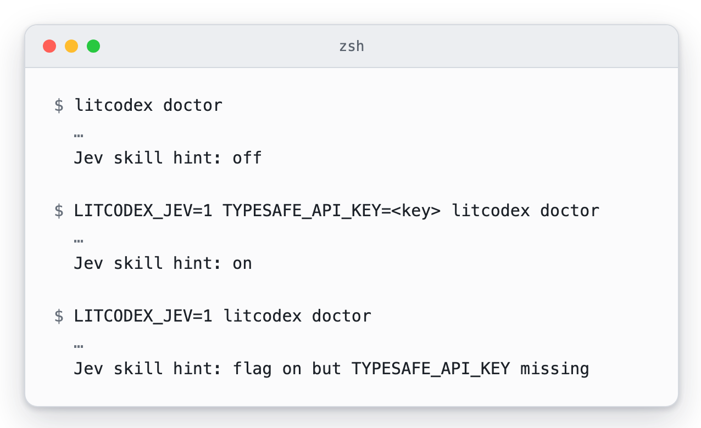

# Jev skill hint (optional)

[README](../README.md) · [한국어](./jev-skill-hint-Ko-KR.md)

Sometimes you type a plain request that one of the bundled skills would handle well. With this option on,
LitCodex asks Jev, a hosted model from TypeSafe (typesafe.ai), which skill fits. When Jev is confident
enough, the `UserPromptSubmit` hook adds one line to the turn's context naming that skill. It is only a
suggestion: Codex still decides whether to load the skill, and the hint grants no permission and runs no
tool.

It is off by default, and [What you will see](#what-you-will-see) below shows each state on screen. To turn it on, set both variables in the environment Codex runs in, then restart Codex:

```sh
export LITCODEX_JEV=1
export TYPESAFE_API_KEY=<your own TypeSafe key>
```

- **Turning it on sends each eligible prompt to TypeSafe (typesafe.ai).** The text is cut to 2,000
  characters, and home paths, email addresses and token-shaped strings are redacted first. Nothing else from
  the session goes with it: no files, tool output or history. Slash commands, `$skill` mentions and prompts
  that already start a lit route are not sent.
- Anything in the prompt without a token shape is sent as written: hostnames, customer names, or passwords
  that are not written as `password=…`, for example.
- `TYPESAFE_API_KEY` is exported in the shell that starts Codex, so Codex's own tools can read it too.
  Give this feature a key of its own with a low spend limit.
- TypeSafe bills your key, at about $0.04 per million input tokens. Each request carries the prompt and the
  skill list. A session makes at most 200 requests (`LITCODEX_JEV_MAX_CALLS`).
- The hint goes to the model, and you normally never see it. If you want to, also set `LITCODEX_JEV_SHOW=1`;
  every turn that got a hint then shows one line in the Codex transcript, such as
  `Jev → lit-humanizer (0.37s)`.
- So you can tell it is on, the first prompt of each session that does not start a lit route shows
  `✦ Jev skill hint ON` once.
- Each request waits at most 1.5 seconds. After a timeout or any other failure the turn carries on without a
  hint, and one short note appears once per session.
- `litcodex doctor` shows `Jev skill hint: off`, `on`, or `flag on but TYPESAFE_API_KEY missing`.
- To turn it off, unset `LITCODEX_JEV` (any value other than `1` also turns it off) and restart Codex.
  See [privacy](./privacy.md#optional-jev-skill-hint).

## What you will see

Jev adds very little to the screen, so it helps to know what each state looks like before you switch it on.
The pictures show Codex CLI 0.158 with the LitCodex hook installed; other Codex versions may word or place hook
lines a little differently. Each caption says whether the picture was captured as it ran or built around a canned
Jev answer, and the skill name in any example is only an example.

With Jev off, which is how LitCodex ships, your prompt goes to Codex as you typed it. LitCodex adds no line to
the transcript and makes no request to TypeSafe.

<p><picture><source media="(prefers-color-scheme: dark)" srcset="./assets/jev/jev-off-dark.webp" /></picture><br /><sub>Captured from a real Codex session with Jev off. The model's reply is trimmed from the picture.</sub></p>

Once Jev is on, the first prompt of each session shows one short line, <code>✦ Jev skill hint ON</code>. It appears
once and tells you that eligible prompts are now going to TypeSafe. A prompt that starts a lit route skips Jev, so
the line waits for the first prompt that does not. In this picture Jev found no skill worth suggesting, so the
notice is all you see.

<p><picture><source media="(prefers-color-scheme: dark)" srcset="./assets/jev/jev-on-notice-dark.webp" /></picture><br /><sub>Sample output. A real Codex session runs LitCodex's own hook, and a canned answer stands in for Jev, so nothing left the machine.</sub></p>

Set `LITCODEX_JEV_SHOW=1` as well and each hinted turn adds a line with the skill's name and how long Jev took.
That is handy while you decide whether Jev suits your work, because you can see which prompts got a suggestion and
how quickly. The first prompt of a session shows the notice and the hint line together, and later prompts show the
hint line alone. Without this variable the hint still reaches Codex, and the transcript stays as quiet as in the
notice picture above.

<p><picture><source media="(prefers-color-scheme: dark)" srcset="./assets/jev/jev-hint-shown-dark.webp" /></picture><br /><sub>Sample output from the same setup, again with a canned Jev answer. The skill name debugging and the 0.30 s are stand-ins; your hints will name other skills and show other times.</sub></p>

If you set `LITCODEX_JEV=1` and forget the key, LitCodex says so once, in a single line, and carries on without a
hint. The prompt still goes to Codex as usual, and nothing is sent to TypeSafe.

<p><picture><source media="(prefers-color-scheme: dark)" srcset="./assets/jev/jev-key-missing-dark.webp" /></picture><br /><sub>Captured from a real Codex session with LITCODEX_JEV=1 and no key.</sub></p>

You can also check the setting without opening Codex. `litcodex doctor` prints one Jev line, and it reads `off`,
`on` or `flag on but TYPESAFE_API_KEY missing`, matching the states above.

<p><picture><source media="(prefers-color-scheme: dark)" srcset="./assets/jev/jev-doctor-dark.webp" /></picture><br /><sub>Captured from litcodex doctor in a temporary home. The rest of each report is left out, and the key is shown as a placeholder.</sub></p>

The pictures and how they were made are listed in the [media notes](./assets/jev/README.md).
