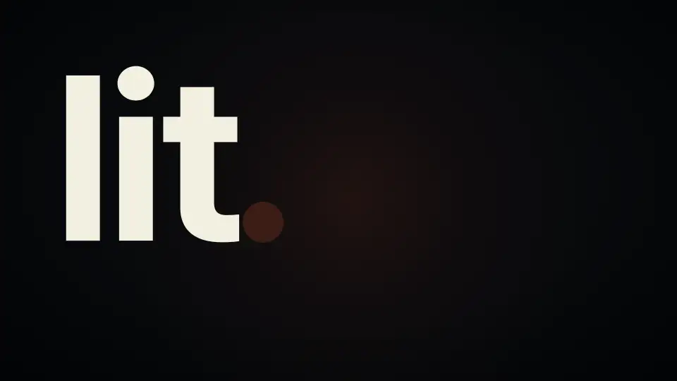

# LitCodex 영상과 브랜드

[README](../README-Ko-KR.md) · [English](./media.md)

영상, 여러 형태의 로고, 이름에 담은 이야기를 모았습니다. README에는 표지 한 장과 화면 사진 한 장만 두고, 나머지는 여기에 있습니다.

## 로고와 배지

<p align="center"></p>

<details>
<summary>ASCII 로고 복사</summary>

```
                             ▄▄▄▄
                   ▗███▌   ▗██████▖
 ▗▄▄▄▄▄          ▗▟████▌   ▝██████▘
 ▐█████        ▗▟██████▌    ▝▀▜█▀▘
 ▐█████      ▗▟███████▄▄▄▄▄▄▄▄▄▄▄▄▄▄▄▄▄▄▄▄
 ▐█████    ▗▟█████████████████████████ ▐█▀
 ▐█████    ████████████████████████████▀
 ▐█████    ██▛▘   ▄ ▄▄▄▄▖▄▄▄▄▄▄▄▄▄▄▄▄▄▖
 ▐█████    ▀    ▄██ ████▌█████████████▌
 ▐█████       ▄████ ████▌█████████████▌
 ▐█████     ▄█████▛
 ▐█████  ▗▟█████▀▘       ▄▄▄▄▄     ▗▖
 ▐█████ ▐█████▀          █████     ▐▛▀
 ▐█████ ▐███▀            █████
 ▐█████ ▐█▀              █████
 ▐█████ ▝                █████
 ▐█████▄▄▄▄▄▄▄▖          █████
 ▐███████████▛           █████
 ▐██████████▀            █████

LIT · codex
```

</details>

<p align="center"></p>
<p align="center"></p>

<p align="center">
<a href="../README-Ko-KR.md#설치"></a>
<a href="../LICENSE"></a>
</p>

<p align="center">
<a href="./usage-Ko-KR.md"> 문서</a> &nbsp; <a href="../README-Ko-KR.md#설치">설치</a> &nbsp; <a href="./assets/readme/ignition-film.mp4"> Ignition</a> &nbsp; <a href="../LICENSE"> MIT</a>
</p>

## 왜 LitCodex인가

**불씨를 건네받았다.<br>
이제, 당신의 작업에 옮길 차례다.**

고치고 싶은 버그 하나. 만들고 싶은 화면 하나. 끝내고 싶은 프로젝트 하나.

시작은 짧은 한 줄이면 됩니다. 어려운 건 그다음입니다. 대화가 길어지고 세션이 바뀌면,
어디까지 했는지부터 다시 짚어야 합니다. 어떤 결정을 내렸는지, 무엇을 확인했는지,
다음에는 무엇을 해야 하는지.

**LIT은 그 불씨를 남깁니다.** 목표와 계획, 확인한 결과, 다음에 할 일을 프로젝트에 기록합니다.
다음 세션에서 그 기록을 읽고 작업을 이어갈 수 있도록.

**대화가 끝난 자리에서, 다음 작업이 시작되도록.**

“꺼지지 않는 불”은 **에이전트가 멈춘 뒤에도 이어갈 작업이 남는다는 뜻입니다.**

<p align="center"> </p>

## 움직이는 모습 보기

23초짜리 영상이 작은 작업 하나가 LitCodex를 거치는 과정을 따라갑니다. 요청에 `lit`을 붙이면 요청이 확인 네 개가 있는 목표가 됩니다. 확인 세 개는 증거가 기록되면 초록색으로 바뀌고, 하나는 열린 채로 남습니다. 인수인계(handoff)가 열린 확인을 다음 세션으로 넘기고, 다음 세션에서 마무리합니다. 영상 속 작업과 확인 항목은 영상을 위해 만든 예시입니다.

<p align="center"><picture><source media="(prefers-reduced-motion: reduce)" srcset="./assets/promo/promo-ko-still.webp" /></picture></p>

[소리와 함께 영상 보기](./assets/promo/promo-ko.mp4) · [포스터](./assets/promo/promo-ko-poster.png)

## LITFAMILY


다섯 제품을 다섯 아머드 머신으로 그린 LIT 패밀리 일러스트입니다.

## Ignition 모션

포스터를 선택하면 10초 영상을 볼 수 있습니다.

<p align="center"><a href="./assets/readme/ignition-film.mp4"></a></p>

[애니메이션 GIF](./assets/readme/ignition-readme.gif) · [미디어·아이콘 출처](./assets/readme/README.md)

## 링크 미리보기 카드

[`social-preview.png`](./assets/social-preview.png)는 링크 미리보기에 쓰는 1280x640 카드입니다. 워드마크, 모션
커버의 LitCodex 패널, `lit-pptx` 스킬에 들어 있는 Pretendard 글꼴로 만들었습니다. `docs/assets/`의 다른 파일처럼
npm 패키지에는 들어가지 않습니다.
