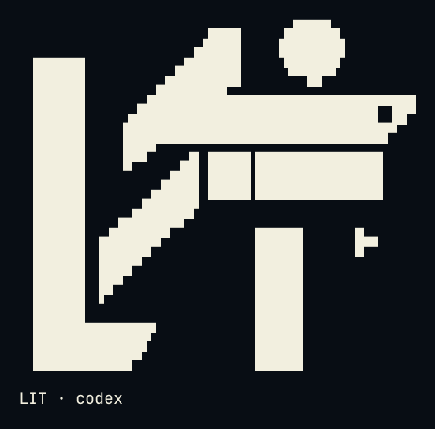
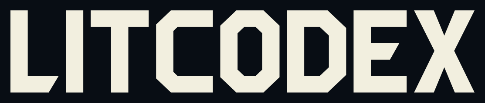
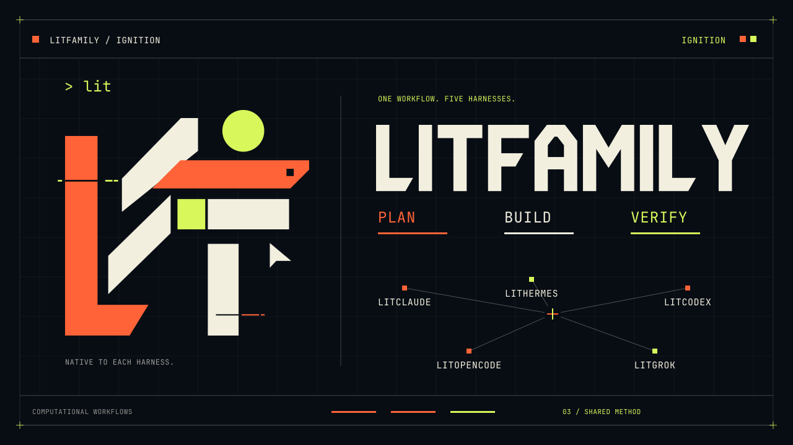

# LitCodex media and brand

[README](../README.md) · [한국어](./media-Ko-KR.md)

The films, the logo in its several forms, and the story behind the name. The README keeps one cover and one screenshot; everything else lives here.

## Logo and badges

<p align="center"></p>

<details>
<summary>Copy ASCII logo</summary>

```
                             ▄▄▄▄
                   ▗███▌   ▗██████▖
 ▗▄▄▄▄▄          ▗▟████▌   ▝██████▘
 ▐█████        ▗▟██████▌    ▝▀▜█▀▘
 ▐█████      ▗▟███████▄▄▄▄▄▄▄▄▄▄▄▄▄▄▄▄▄▄▄▄
 ▐█████    ▗▟█████████████████████████ ▐█▀
 ▐█████    ████████████████████████████▀
 ▐█████    ██▛▘   ▄ ▄▄▄▄▖▄▄▄▄▄▄▄▄▄▄▄▄▄▖
 ▐█████    ▀    ▄██ ████▌█████████████▌
 ▐█████       ▄████ ████▌█████████████▌
 ▐█████     ▄█████▛
 ▐█████  ▗▟█████▀▘       ▄▄▄▄▄     ▗▖
 ▐█████ ▐█████▀          █████     ▐▛▀
 ▐█████ ▐███▀            █████
 ▐█████ ▐█▀              █████
 ▐█████ ▝                █████
 ▐█████▄▄▄▄▄▄▄▖          █████
 ▐███████████▛           █████
 ▐██████████▀            █████

LIT · codex
```

</details>

<p align="center"></p>
<p align="center"></p>

<p align="center">
<a href="../README.md#install"></a>
<a href="../LICENSE"></a>
</p>

<p align="center">
<a href="./usage.md"> Docs</a> &nbsp; <a href="../README.md#install">Install</a> &nbsp; <a href="./assets/readme/ignition-film.mp4"> Ignition</a> &nbsp; <a href="../LICENSE"> MIT</a>
</p>

## Why LitCodex

**You have been handed a spark.<br>
Bring it to the work you want to finish.**

A bug to fix. A screen to build. A project to finish.

Starting takes a sentence. Picking up where you left off takes more: the decisions you made,
the checks you ran, and the next thing to try.

**LIT keeps that spark with your project.** Goals, plans, checked results and next steps stay in
local records that a later session can read. The spark that lasts is the work you can come back to,
long after the agent has stopped.

**Where one conversation ends, the next stretch of work can begin.**

<p align="center"> </p>

## Watch it in motion

A 23-second film follows one small task through LitCodex. You add `lit` to a request, and the request becomes a goal with four checks. Three checks turn green once their evidence is recorded, and one stays open. A handoff carries the open check into the next session, where it gets finished. The task and its checks are an example made for the film.

<p align="center"><picture><source media="(prefers-reduced-motion: reduce)" srcset="./assets/promo/promo-still.webp" /></picture></p>

[Watch the film with sound](./assets/promo/promo.mp4) · [Poster](./assets/promo/promo-poster.png)

## LITFAMILY


Seven armored machines, one for each product in the LIT family.

## Ignition motion

Select the poster to watch the 10-second film.

<p align="center"><a href="./assets/readme/ignition-film.mp4"></a></p>

[Animated GIF](./assets/readme/ignition-readme.gif) · [Media and icon credits](./assets/readme/README.md)

## Link preview card

[`social-preview.png`](./assets/social-preview.png) is the 1280x640 card for link previews, built from the wordmark,
the LitCodex panel of the motion cover and the Pretendard type that ships with the `lit-pptx` skill. Like the rest
of `docs/assets/`, it stays out of the npm package.
