# LitCodex 스킬

[README](../README-Ko-KR.md) · [English](./skills.md)

## 스킬 한눈에 보기

번들 스킬을 모두 모았습니다. 줄마다 시작하는 방법과 얻는 것을 적었고, 마지막 줄은 알아서 돌아가는 검사를 묶었습니다.

<table>
<tr><th>이렇게 됩니다</th><th>스킬</th><th>얻는 것</th></tr>
<tr>
<td>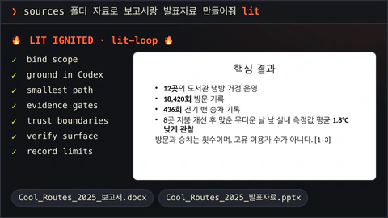</td>
<td><code>lit-loop</code> <code>lit</code> · <code>$litcodex:lit-loop</code></td>
<td>요청에 <code>lit</code>만 붙이세요. 범위를 정하고 단계마다 확인하며 일하고, 확인하지 못한 것은 그대로 적어 둡니다.</td>
</tr>
<tr>
<td>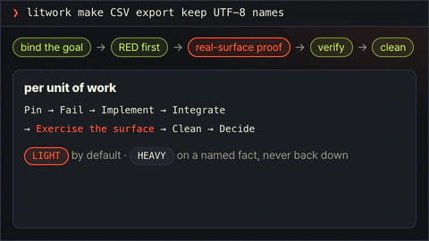</td>
<td><code>litwork</code> <code>litwork</code> · <code>$litcodex:litwork</code></td>
<td>처음부터 끝까지 꼼꼼한 구현이나 수정입니다. 실패하는 테스트 먼저, 그다음 실제 화면에서 증명합니다.</td>
</tr>
<tr>
<td>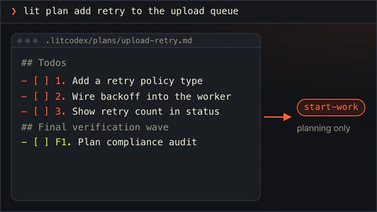</td>
<td><code>lit-plan</code> <code>lit plan</code> · <code>$litcodex:lit-plan</code></td>
<td><code>.litcodex/plans/</code>에 번호 붙은 작업 목록을 만듭니다. 계획만 세웁니다.</td>
</tr>
<tr>
<td>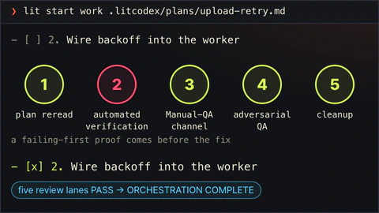</td>
<td>Start Work <code>lit start work &lt;approved-plan&gt;</code></td>
<td>승인된 계획을 다섯 관문으로 실행합니다. 끝에는 리뷰 다섯 개를 모두 통과해야 합니다.</td>
</tr>
<tr>
<td>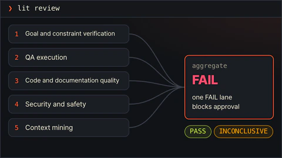</td>
<td><code>review-work</code> <code>lit review</code> · <code>$litcodex:review-work</code></td>
<td>리뷰 다섯 개가 따로 돌고, 하나라도 통과하지 못하면 승인이 나지 않습니다.</td>
</tr>
<tr>
<td>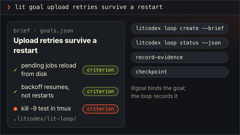</td>
<td><code>litgoal</code> <code>lit goal</code> · <code>$litcodex:litgoal</code></td>
<td>눈으로 확인할 수 있는 기준을 단 목표 하나를 lit-loop에 걸어, 세션이 바뀌어도 이어지게 합니다.</td>
</tr>
<tr>
<td>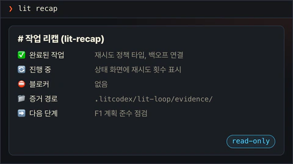</td>
<td><code>lit-recap</code> <code>lit recap</code> · <code>$litcodex:lit-recap</code></td>
<td>읽기 전용 요약입니다. 끝난 일, 진행 중인 일, 막힌 곳, 증거 위치, 다음 단계를 보여줍니다.</td>
</tr>
<tr>
<td>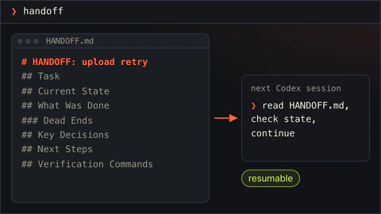</td>
<td><code>lit-handoff</code> <code>handoff</code> · <code>/lit-handoff</code></td>
<td><code>handoff</code>라고 치면 다음 세션이 읽고 이어갈 인수인계 파일이 생깁니다.</td>
</tr>
<tr>
<td>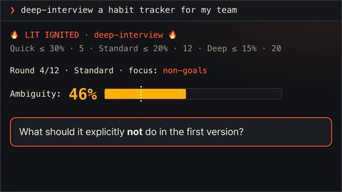</td>
<td><code>deep-interview</code> <code>deep-interview</code> · <code>$litcodex:deep-interview</code></td>
<td>한 번에 한 질문씩 물어 만들 수 있을 만큼 분명하게 다듬습니다. Quick, Standard, Deep 중에서 목표를 고릅니다.</td>
</tr>
<tr>
<td>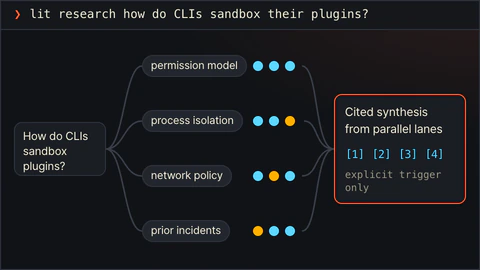</td>
<td><code>litresearch</code> <code>lit research</code> · <code>$litcodex:litresearch</code></td>
<td>조사를 요청할 때만 움직입니다. 여러 갈래로 증거를 모아 출처와 함께 종합합니다.</td>
</tr>
<tr>
<td>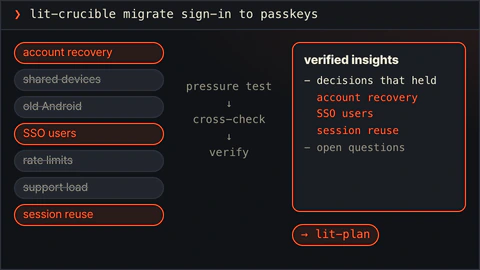</td>
<td><code>lit-crucible</code> <code>lit-crucible</code> · <code>$litcodex:lit-crucible</code></td>
<td>계획 전에 요구사항을 반박해 봅니다. 반박을 견딘 위험만 계획으로 넘어갑니다.</td>
</tr>
<tr>
<td>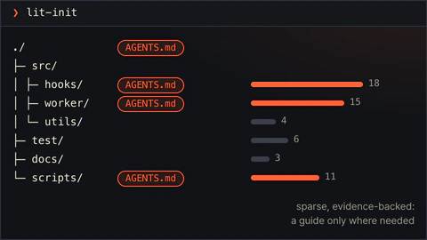</td>
<td><code>lit-init</code> <code>lit-init</code> · <code>$litcodex:lit-init</code></td>
<td>저장소에 실제로 있는 것을 근거로, 필요한 곳에만 짧은 AGENTS.md 안내를 만듭니다.</td>
</tr>
<tr>
<td>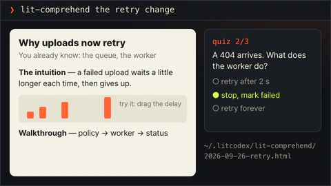</td>
<td><code>lit-comprehend</code> <code>lit-comprehend</code> · <code>$litcodex:lit-comprehend</code></td>
<td>에이전트가 쓴 작업을 이해하도록 돕는 설명 페이지입니다. 직관, 흐름 설명, 짧은 퀴즈 순서입니다.</td>
</tr>
<tr>
<td>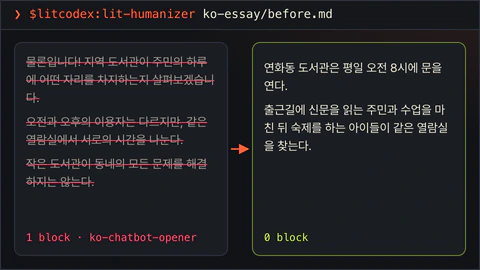</td>
<td><code>lit-humanizer</code> <code>$litcodex:lit-humanizer</code></td>
<td>딱딱한 AI 문장을 한국어나 영어로 다시 씁니다. 사실과 단서는 남기고 군더더기는 뺍니다.</td>
</tr>
<tr>
<td>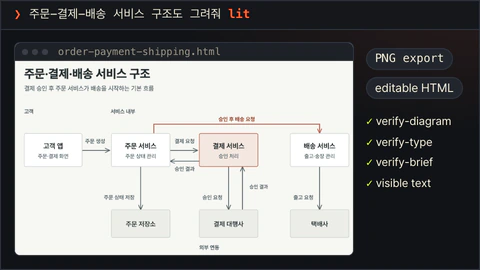</td>
<td><code>lit-diagram-drawer</code> <code>$litcodex:lit-diagram-drawer</code></td>
<td>슬라이드와 문서에 넣을 다이어그램을 편집 가능한 형태로 그리고, 검사한 뒤 PNG와 SVG로 내보냅니다.</td>
</tr>
<tr>
<td>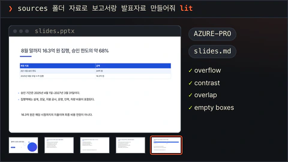</td>
<td><code>lit-pptx</code> <code>$litcodex:lit-pptx</code></td>
<td><code>lit</code>으로 발표자료를 요청하면 내용에 맞는 디자인 방향 여덟 가지 중 하나를 먼저 고르고, 고른 방향과 대안 두 가지를 밝힌 뒤 Pretendard로 빽빽하게 채운 편집 가능한 PowerPoint 파일과 원고 Markdown을 만듭니다. 배치, 제목 다양성, 채움을 검사하고 LibreOffice가 있으면 렌더링된 슬라이드도 확인합니다.</td>
</tr>
<tr>
<td>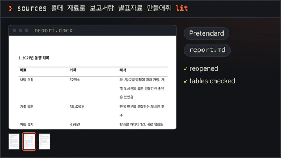</td>
<td><code>lit-docx</code> <code>$litcodex:lit-docx</code></td>
<td><code>lit</code>으로 보고서를 요청하면 문서 방향 여섯 가지 중 하나를 고르고 대안 두 가지와 함께 밝힌 뒤, 절제된 인쇄물 품질의 Word 파일과 원고 Markdown을 만듭니다. 제목, 절제 규칙, LibreOffice가 있으면 렌더링된 페이지까지 검사합니다.</td>
</tr>
<tr>
<td>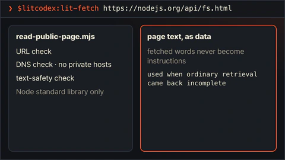</td>
<td><code>lit-fetch</code> <code>$litcodex:lit-fetch</code></td>
<td>보통 방법으로 부족할 때, 주소·DNS·본문 안전 검사를 거쳐 공개 페이지를 읽습니다.</td>
</tr>
<tr>
<td>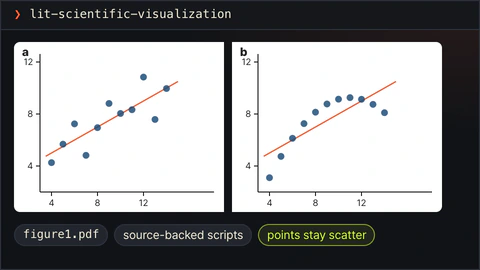</td>
<td><code>lit-scientific-visualization</code> <code>lit-scientific-visualization</code> · <code>$litcodex:lit-scientific-visualization</code></td>
<td>학술지 규격 그림을 벡터와 600 DPI로 내보냅니다. 그래프 종류는 데이터 성격에 맞춰 고릅니다.</td>
</tr>
<tr>
<td>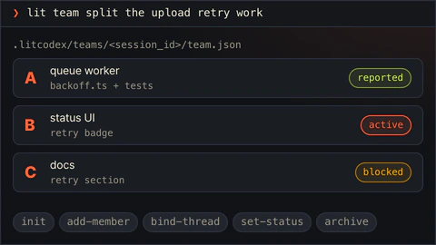</td>
<td><code>lit-team</code> <code>lit team</code> · <code>$litcodex:lit-team</code></td>
<td>여러 작업자에게 겹치지 않는 몫을 나누고, 각자 증거와 함께 보고하게 합니다.</td>
</tr>
<tr>
<td>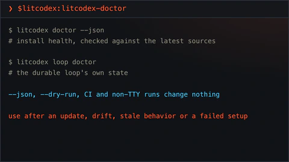</td>
<td><code>litcodex-doctor</code> <code>$litcodex:litcodex-doctor</code></td>
<td>업데이트나 설정 실패 뒤에 LitCodex와 Codex 설치 상태를 점검합니다.</td>
</tr>
<tr>
<td>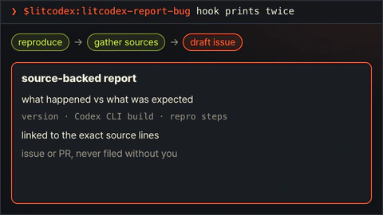</td>
<td><code>litcodex-report-bug</code> <code>$litcodex:litcodex-report-bug</code></td>
<td>LitCodex나 Codex의 버그 보고서를 출처와 함께 작성합니다.</td>
</tr>
<tr>
<td>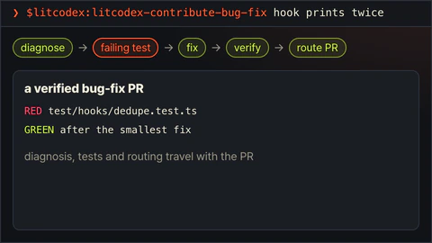</td>
<td><code>litcodex-contribute-bug-fix</code> <code>$litcodex:litcodex-contribute-bug-fix</code></td>
<td>진단한 결함을 테스트가 붙은 수정 PR로 만듭니다.</td>
</tr>
<tr>
<td>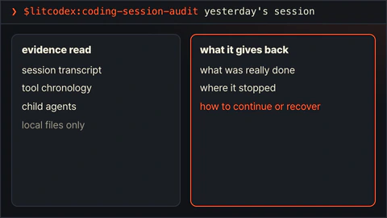</td>
<td><code>coding-session-audit</code> <code>$litcodex:coding-session-audit</code></td>
<td>지난 Codex 세션을 기록으로 읽고, 어디서 멈췄는지 보여줍니다.</td>
</tr>
<tr>
<td>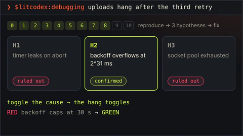</td>
<td><code>debugging</code> <code>$litcodex:debugging</code></td>
<td>버그를 재현하고, 가설을 세 개 이상 세워 확인한 뒤, 확인된 원인만 고칩니다.</td>
</tr>
<tr>
<td>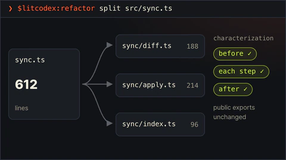</td>
<td><code>refactor</code> <code>$litcodex:refactor</code></td>
<td>동작을 테스트로 고정한 채 코드 구조를 바꿉니다. 단계마다 확인합니다.</td>
</tr>
<tr>
<td>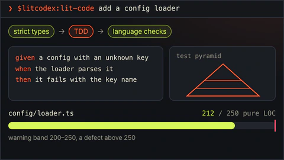</td>
<td><code>lit-code</code> <code>$litcodex:lit-code</code></td>
<td>엄격한 구현 규칙입니다. 테스트 먼저, 경계에서 타입 확인, 작은 파일.</td>
</tr>
<tr>
<td>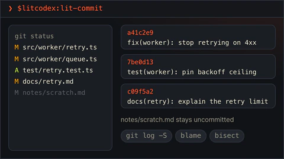</td>
<td><code>lit-commit</code> <code>$litcodex:lit-commit</code></td>
<td>변경을 저장소 스타일에 맞는 작은 커밋으로 나눕니다. 관계없는 작업은 건드리지 않습니다.</td>
</tr>
<tr>
<td>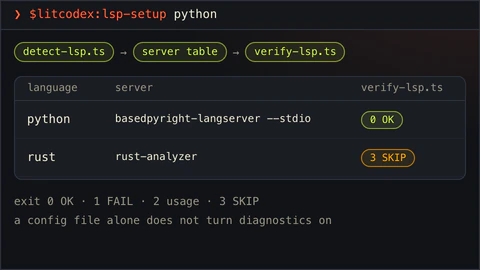</td>
<td><code>lsp-setup</code> <code>$litcodex:lsp-setup</code></td>
<td>언어 서버 설정을 확인하고, 필요할 때 실제 진단 검사를 돌립니다.</td>
</tr>
<tr>
<td>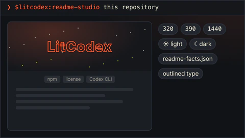</td>
<td><code>readme-studio</code> <code>$litcodex:readme-studio</code></td>
<td>사실에 맞는 README와 움직이는 커버를 만들고, 휴대폰과 데스크톱 폭, 라이트와 다크 모드에서 확인합니다.</td>
</tr>
<tr>
<td>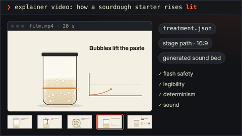</td>
<td><code>lit-typographic-motion</code> <code>$litcodex:lit-typographic-motion</code></td>
<td><code>lit</code>으로 영상을 요청하면 트리트먼트를 먼저 쓰고, 직접 만든 무대 페이지나 타입 엔진으로 영상을 만들고, 사운드를 입힌 뒤 렌더링된 스틸을 보며 다듬습니다.</td>
</tr>
<tr>
<td>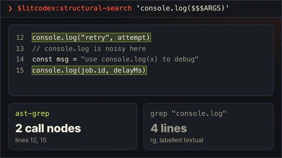</td>
<td><code>structural-search</code> <code>$litcodex:structural-search</code></td>
<td>글자 대신 문법 구조로 코드를 찾고, 바꾸기 전에 결과를 미리 보여줍니다.</td>
</tr>
<tr>
<td>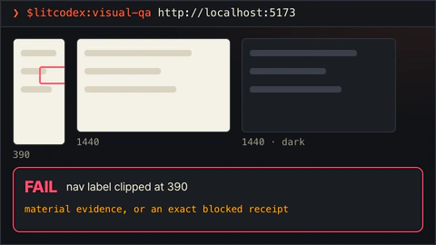</td>
<td><code>visual-qa</code> <code>$litcodex:visual-qa</code></td>
<td>실제 화면을 폭별로 확인해 결과를 정직하게 돌려줍니다. 막히면 무엇이 막았는지 정확히 알려줍니다.</td>
</tr>
<tr>
<td>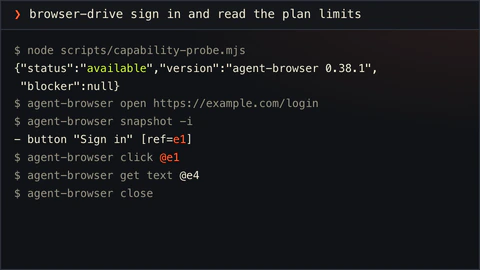</td>
<td><code>browser-drive</code> <code>browser-drive</code> · <code>$litcodex:browser-drive</code></td>
<td>브라우저 드라이버를 먼저 확인한 뒤 실제 페이지를 조작합니다. 드라이버가 없으면 그렇다고 말합니다.</td>
</tr>
<tr>
<td>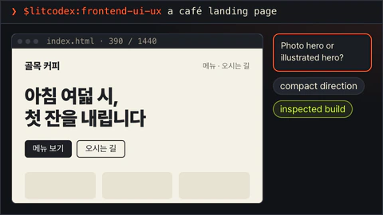</td>
<td><code>frontend-ui-ux</code> <code>$litcodex:frontend-ui-ux</code></td>
<td>실제로 동작하는 화면을 만들고, 측정 프로브로 일곱 가지 보기를 렌더링합니다. 네 가지 폭, 다크 모드, 모션 줄이기, 200% 확대입니다.</td>
</tr>
<tr>
<td>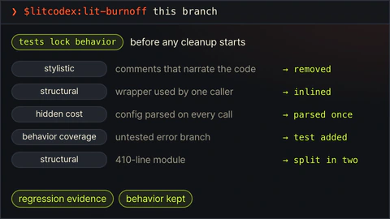</td>
<td><code>lit-burnoff</code> <code>$litcodex:lit-burnoff</code></td>
<td>테스트로 동작을 먼저 묶어 두고, 변경분에 붙은 AI식 군더더기를 걷어냅니다.</td>
</tr>
<tr>
<td>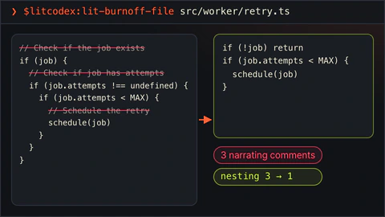</td>
<td><code>lit-burnoff-file</code> <code>$litcodex:lit-burnoff-file</code></td>
<td>파일 하나만 정리합니다. 설명조 주석과 과한 방어 코드를 줄이고 중첩을 펴줍니다.</td>
</tr>
<tr>
<td>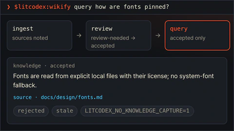</td>
<td><code>wikify</code> <code>$litcodex:wikify</code></td>
<td>검토를 거친 프로젝트 지식을 디스크에 두고, 나중 질문에 출처와 함께 답합니다.</td>
</tr>
<tr>
<td>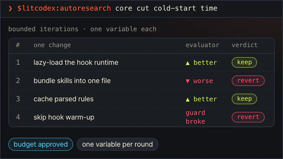</td>
<td><code>autoresearch</code> <code>$litcodex:autoresearch</code></td>
<td>승인된 예산 안에서 실험을 반복합니다. 한 번에 하나만 바꾸고, 결과에 따라 남기거나 되돌립니다.</td>
</tr>
<tr>
<td>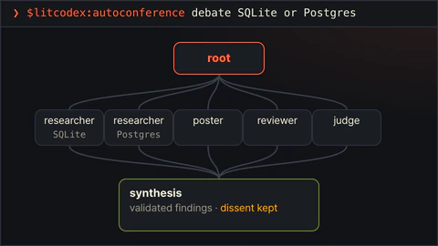</td>
<td><code>autoconference</code> <code>$litcodex:autoconference</code></td>
<td>예산을 정한 연구 회의입니다. 연구자와 리뷰어가 따로 일하고, 종합에는 반대 의견도 남깁니다.</td>
</tr>
<tr>
<td>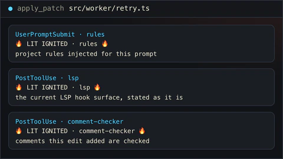</td>
<td><code>rules</code> · <code>lsp</code> · <code>comment-checker</code> 자동 실행</td>
<td>알아서 돌아갑니다. 프롬프트마다 프로젝트 규칙을 넣고, 수정 뒤에는 LSP와 주석을 확인합니다.</td>
</tr>
</table>

## 이름으로 스킬 고르기

`$litcodex:lit-fetch`처럼 `$litcodex:` 접두어를 붙인 이름으로 불러도 됩니다.

이름을 알아 두면 편한 스킬도 몇 가지 있습니다.

- **다이어그램.** 아키텍처, 워크플로, 시스템, 개념 다이어그램은 Codex skill picker에서 `lit-diagram-drawer`를
  고르세요. `lit`으로 다이어그램을 요청해도 이 스킬을 읽도록 안내합니다. 제품 화면과 측정 데이터 그래프는 각자
  전용 스킬이 있습니다.
- **Word와 PowerPoint.** 보고서·기획서는 `lit-docx`, 발표자료는 `lit-pptx`를 고릅니다. `lit`으로 둘 중 하나를
  요청하면 맞는 스킬을 알아서 읽고, 둘 다 요청하면 둘 다 씁니다. 두 스킬은 만들기 전에 자료를 읽고 이것이 어떤
  덱이나 문서인지부터 정합니다. 숫자 위주의 실적 보고인지, 발표용 피치인지, 강의인지, 읽히는 한국어 보고서형
  덱인지, 또는 보고서, 한 장짜리 안내문, 제안서, 절차서인지를 봅니다. 그러고는 고른 디자인 방향과 함께 검토한
  대안 두 가지를 밝히고, 질문 없이 바로 만듭니다. 발표자료는 Ledger, Signal, Atlas, Chalk, Paper, Gazette,
  Studio, Night 여덟 방향이 있고, 방향마다 색과 제목 위치와 레이아웃이 다르며, 슬라이드마다 요점을 받치는 사실을
  아래쪽까지 채워 넣습니다. 제목은 주제를 이름으로 붙이고 주장은 본문 첫 줄에 두며, 숫자는 잰 그대로 씁니다.
  문서는 Report, Brief, Manual, Proposal, Memo, Journal 여섯 방향이 있고, 첫 쪽에 무엇이 오는지, 요약을 어떻게
  쓰는지, 절에 번호를 붙이는지 같은 구조가 서로 다릅니다. 모두 연구기관 보고서처럼 검은 제목, 칸을 칠하지 않은
  표, 많아야 한 가지 강조색으로 인쇄되고, 한국어 문서는 날짜·표 캡션·단위·줄바꿈을 한국어 관례대로 씁니다.
  어느 쪽이든 편집 가능한 Markdown 원본이 DOCX/PPTX 옆에 남고, 다른 방향을 원하면 결과를 보고 말하면 됩니다. 두 스킬에 필요한 고정 버전 도구는 `litcodex install`이 Codex 세션 밖에서 미리 받아
  둡니다. 준비됐는지는 `litcodex office-runtime status`나 `litcodex doctor`로 확인하세요. 네트워크 없이 설치했다면
  나중에 샌드박스 밖에서 `litcodex office-runtime install`을 실행하면 됩니다. LibreOffice·pandoc·XeLaTeX처럼 선택적으로
  쓰는 도구가 있는지는 Office 실행기의 doctor 명령이 알려 줍니다.
- **글 다듬기.** 영어·한국어 글은 `lit-humanizer`를 고르세요. 파일에 쓰기 직전에 훅이 누가 봐도 초안 티가 나는
  표현 몇 가지는 막고, 애매한 것은 막지 않고 짚어만 줍니다. Office·PDF 파일은 호스트가 텍스트를 꺼낼 수 있으면
  만들어진 직후에 확인합니다.

## 이름이 바뀐 스킬

전체 스킬은 Codex skill picker에서 볼 수 있습니다. 이름이 바뀐 스킬은 한 릴리스 동안 예전 이름으로도 불러집니다.
[이름 전환 정책](./usage-Ko-KR.md#스킬-이름-전환)과 [CHANGELOG.md](../CHANGELOG.md)를 참고하세요.
